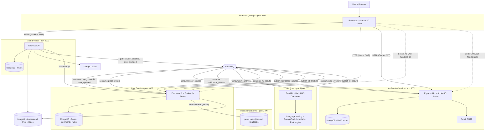
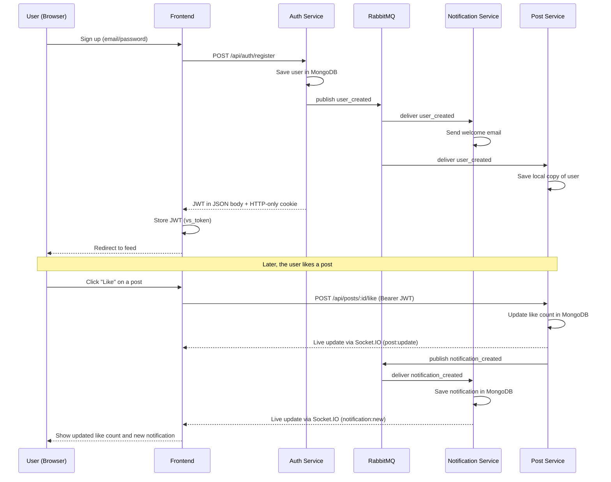
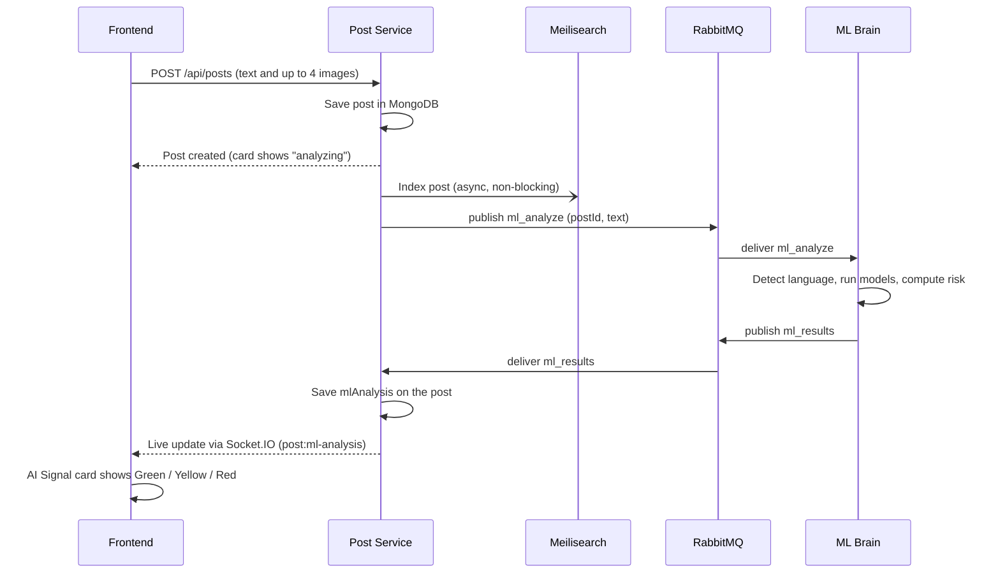
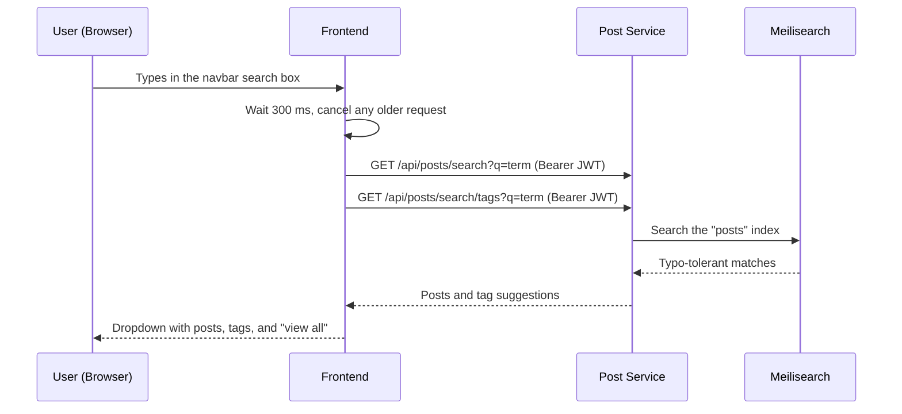

# VerbaScope

VerbaScope is a social platform where people can sign up, build a profile, share posts, follow each other, and interact in real time through likes, comments, shares, bookmarks, and notifications. Every text post is also analyzed by an ML service that returns a Green / Yellow / Red "AI Signal" (language, sentiment, sarcasm, toxicity) to encourage reflection rather than punish users. Posts are searchable through a typo-tolerant full-text search server (Meilisearch).

The project is built as a set of small backend services (a "microservices" setup), one frontend application, and one search server. Each service has one job, and they talk to each other over HTTP and through a message queue (RabbitMQ). This README gives you the big picture. Each service also has its own README with more detail (endpoints, file-by-file guides, caveats, and interview questions).

## What's in this project

| Component | What it does | Port |
|---|---|---|
| **Frontend** | The website people actually use: login, feed, profiles, search, bookmarks, live updates | 3002 |
| **Auth Service** | Sign up, login, Google sign-in, user profiles, avatars, and follow/unfollow | 3000 |
| **Notification Service** | Sends emails and delivers in-app notifications in real time | 3001 |
| **Post Service** | Posts, likes, comments, shares, bookmarks, search API, and recommendations | 3003 |
| **ML Brain** | Python inference service: language detection, sentiment, sarcasm, toxicity, and the Green/Yellow/Red risk signal | 8000 |
| **Meilisearch** | Standalone full-text search server used by the Post Service (a derived, rebuildable index, not a source of truth) | 7700 |

Supporting infrastructure: **MongoDB** (data), **RabbitMQ** (events between services), **ImageKit** (image hosting), **Gmail SMTP** (email), and **Google OAuth** (sign-in).

## How it all fits together

1. A user opens the **Frontend** and logs in. The frontend talks to the **Auth Service**, which returns a JWT (also set as an HTTP-only cookie for the auth service itself).
2. The frontend stores the JWT and sends it as an `Authorization: Bearer <token>` header to the **Post** and **Notification** services. These services verify the same JWT independently using the shared `JWT_SECRET`.
3. Once logged in, the frontend loads the feed from the **Post Service**: posts, likes, comments, shares, bookmarks.
4. When a user publishes a post, the **Post Service** saves it in MongoDB, then (without making the user wait) indexes it in **Meilisearch**. If the post has text, it is also sent to the **ML Brain** through RabbitMQ. The ML Brain analyzes it and sends the result back, and the Post Service pushes it to the frontend over Socket.IO so the post card's AI Signal updates without a refresh.
5. When a user types in the navbar search box, the frontend calls the **Post Service** search API, which queries **Meilisearch** for matching posts and tags.
6. When something happens that a user should know about (someone liked their post, for example), the **Post Service** tells the **Notification Service** through RabbitMQ, and the **Notification Service** pushes a live update to the frontend using Socket.IO, and/or sends an email.

In short: **Auth** handles "who are you", **Post** handles "what did you post and how did people react", **Meilisearch** handles "find posts fast", **ML Brain** handles "what does this text signal", and **Notification** handles "let the user know what happened". The **Frontend** ties them together into one app.

## Architecture Diagram



## Data Flow Diagrams

### Sign up and like a post

A user signs up, then later likes someone else's post.



### Publishing a post, indexing it, and the AI Signal



### Searching for posts



## Tech Stack (shared across the project)

- **Node.js + Express** for the Auth, Post, and Notification services
- **Python + FastAPI + PyTorch/Transformers** for the ML Brain
- **MongoDB + Mongoose** for data storage in the Node services
- **Meilisearch** as a standalone full-text search server for posts (MongoDB stays the source of truth)
- **RabbitMQ** for services to send events to each other (e.g. "a new user signed up", "analyze this post")
- **Socket.IO** for real-time updates (likes, comments, AI analysis, notifications) without refreshing the page
- **JWT** for sessions: stored in an HTTP-only cookie by the Auth Service, and also returned in the JSON response so the frontend can send it as a Bearer token to the other services
- **ImageKit** for storing uploaded images (avatars and post photos)
- **Nodemailer + Gmail SMTP** for account emails
- **Next.js + React + TypeScript** for the frontend

## Project Layout

```
verbascope-social-ml/
├── services/
│   ├── auth-service/         # Sign up, login, profiles, follow/unfollow
│   ├── post-service/         # Posts, likes, comments, shares, bookmarks, search, recommendations
│   ├── notification-service/ # Emails and in-app notifications
│   ├── ml-brain/             # Language routing, sentiment/sarcasm/toxicity, risk signal
│   └── frontend/             # The Next.js website
```

Each folder is its own independent app with its own dependency file (`package.json` or `requirements.txt`) and its own environment file. Meilisearch is **not** a folder in this repository: it is a separate server (a downloaded binary today) that the Post Service connects to. Its code lives in `services/post-service/src/search/`.

## Getting Started

You'll need each service running at the same time for the full app to work. A typical order is:

1. **Start MongoDB, RabbitMQ, and Meilisearch** locally (or point the `.env` files to hosted versions). See [Running Meilisearch](#running-meilisearch) below. Meilisearch is optional for the app to boot, but search won't work without it.
2. **Auth Service**: handles logins, so start this first.
3. **Notification Service**: listens for events like new signups and post activity.
4. **Post Service**: depends on users existing and on the Auth Service being reachable (for profile lookups), so start it after Auth.
5. **ML Brain**: consumes post-analysis jobs from RabbitMQ. Posts still work without it, but AI Signals won't be produced.
6. **Frontend**: connects to the services above.

For each Node.js service (auth, notification, post):

```bash
cd services/<service-name>
npm install
npm run dev
```

For the frontend (runs on port 3002):

```bash
cd services/frontend
npm install
npm run dev
```

For the ML Brain (Python 3.10+; the first run downloads Hugging Face models, so it can be slow):

```powershell
cd services/ml-brain
python -m venv .venv
.\.venv\Scripts\Activate.ps1
python -m pip install -r requirements.txt
uvicorn main:app --host 0.0.0.0 --port 8000
```

Note that `python main.py` alone does not start the HTTP server; use `uvicorn`. Wait until `GET http://localhost:8000/health` reports `model_loaded: true` before relying on it. Once everything is running, open the frontend at `http://localhost:3002`.

### Running Meilisearch

Meilisearch is a single lightweight binary. No Docker is used yet (Dockerization is a later milestone), so the binary is run directly in its own terminal and left running during development. On Windows:

```cmd
cd C:\meilisearch
meilisearch-windows-amd64.exe --master-key="dev_master_key_change_me"
```

This starts an instance on `http://localhost:7700` and stores its data in `data.ms` next to the binary (data survives restarts). On other operating systems, download the matching binary from Meilisearch's releases and pass the same `--master-key` flag.

Verify the connection once the Post Service is running:

```bash
curl http://localhost:3003/api/posts/search/health
# {"status":"ok","meilisearch":"available"}
```

If Meilisearch is down, the Post Service logs a warning (`Meilisearch unavailable - search disabled`) and keeps running normally. See [Full-Text Search (Meilisearch)](#full-text-search-meilisearch) for how the index works.

## Environment Variables

Each service has its own environment file. Here's a quick summary; see each service's README for the full list.

**Auth Service** (`services/auth-service/.env`)
```env
MONGO_URI=your_mongodb_connection_string
JWT_SECRET=your_jwt_secret
JWT_EXPIRES_IN=7d
GOOGLE_CLIENT_ID=your_google_client_id
GOOGLE_CLIENT_SECRET=your_google_client_secret
GOOGLE_CALLBACK_URL=http://localhost:3000/api/auth/google/callback
RABBITMQ_URI=amqp://localhost
IMAGEKIT_PUBLIC_KEY=your_imagekit_public_key
IMAGEKIT_PRIVATE_KEY=your_imagekit_private_key
IMAGEKIT_URL_ENDPOINT=https://ik.imagekit.io/your_instance
CLIENT_URL=http://localhost:3002
```

`JWT_EXPIRES_IN` is optional (default `7d`). Google credentials can alternatively be supplied as `CLIENT_ID` and `CLIENT_SECRET`.

**Post Service** (`services/post-service/.env`)
```env
MONGO_URI=your_mongodb_connection_string
JWT_SECRET=your_jwt_secret
RABBITMQ_URI=amqp://localhost:5672
PORT=3003
CLIENT_URL=http://localhost:3002
AUTH_SERVICE_URL=http://localhost:3000
MEILI_HOST=http://localhost:7700
MEILI_MASTER_KEY=dev_master_key_change_me
IMAGEKIT_PUBLIC_KEY=your_imagekit_public_key
IMAGEKIT_PRIVATE_KEY=your_imagekit_private_key
IMAGEKIT_URL_ENDPOINT=https://ik.imagekit.io/your_instance
```

`MEILI_HOST` defaults to `http://localhost:7700` and `MEILI_MASTER_KEY` defaults to a development placeholder. `AUTH_SERVICE_URL` is needed for author/profile lookups. `dev_master_key_change_me` is a local-only placeholder: **replace it with a strong, random key (on both the Meilisearch server and the Post Service) before any non-local deployment.**

**Notification Service** (`services/notification-service/.env`)
```env
MONGO_URI=your_mongodb_connection_string
JWT_SECRET=your_jwt_secret
RABBITMQ_URI=amqp://localhost
EMAIL_USER=your_gmail_address
EMAIL_PASS=your_gmail_app_password
CLIENT_URL=http://localhost:3002
PORT=3001
```

`EMAIL_PASS` should be a Gmail app password when the account uses two-step verification. `PORT` is optional (default `3001`).

**ML Brain** (`services/ml-brain/.env`)
```env
RABBITMQ_URL=amqp://localhost
ML_API_KEY=optional_key_for_the_analyze_endpoint
```

The ML Brain uses `RABBITMQ_URL` (not `RABBITMQ_URI` like the Node services). `ML_API_KEY` is optional: when set, `POST /analyze` requires a matching `X-API-Key` header; when unset, `/analyze` is open. An optional `USE_MIXED_PIPELINE=0` switches off the experimental code-mixed pipeline. The HTTP port is set by the `uvicorn` command, not by an environment variable.

**Frontend** (`services/frontend/.env.local`)
```env
NEXT_PUBLIC_AUTH_API_URL=http://localhost:3000
NEXT_PUBLIC_AUTH_URL=http://localhost:3000
NEXT_PUBLIC_NOTIFICATION_API_URL=http://localhost:3001
NEXT_PUBLIC_POST_API_URL=http://localhost:3003
NEXT_PUBLIC_API_URL=http://localhost:3003
NEXT_PUBLIC_IMAGEKIT_PUBLIC_KEY=your_imagekit_public_key
NEXT_PUBLIC_IMAGEKIT_URL_ENDPOINT=https://ik.imagekit.io/your_instance
```

The frontend never talks to Meilisearch directly; search goes through the Post Service (`NEXT_PUBLIC_API_URL` is used by the search client).

> **Important:** The `JWT_SECRET` value must be the same across the Auth, Post, and Notification services. Each service verifies the same JWT on its own, which is how one login works across all of them.

## Core Features

- **Accounts:** Email/password sign up and login, plus Google sign-in
- **Profiles:** Bio, headline, avatar uploads, and viewing other users' profiles
- **Social graph:** Follow and unfollow other users
- **Posts:** Create posts with up to 4 images (max 5 MB each, text up to 3,000 characters), view a feed, view posts by user, and open a post detail page
- **Engagement:** Like, comment (with threaded replies), share (with a reason), and bookmark posts
- **Search:** Fast, typo-tolerant full-text search over posts and tags from the navbar (powered by Meilisearch), with tag pages and a full search page. People search is not implemented yet.
- **Recommendations:** Suggested users to follow based on shared interests, plus trending hashtags and weekly pulse topics
- **Community Insights:** Share reasons (`agree`, `funny`, `needs_attention`, `insightful`, `concerning`, `educational`) from you and the people you follow can be used to filter the feed
- **AI Signal:** Each text post gets a Green / Yellow / Red signal with a short explanation and details such as language, sentiment, sarcasm, toxicity level, and confidence. Bangla and English are supported. The signal is guidance for reflection; it does not delete posts or penalize accounts.
- **Notifications:** Real-time in-app notifications and welcome emails
- **Live updates:** New likes, comments, shares, AI analysis results, and notifications appear instantly without a page refresh
- **Theme:** Light/dark theme resolved on the server to avoid a flash on first load

## Service Summaries

### Auth Service (port 3000)

The authentication and user-profile backbone. Registers and authenticates users (bcrypt-hashed passwords, express-validator input checks), issues JWTs (in an HTTP-only `token` cookie and in the JSON response), supports Google OAuth through Passport (linking an existing email account or creating a new one), manages profiles and avatars (ImageKit), handles follow/unfollow, and publishes `user_created` / `user_updated` events.

Key endpoints: `POST /api/auth/register`, `POST /api/auth/login`, `GET /api/auth/google` and `/google/callback`, `GET /api/auth/me`, `POST /api/auth/logout`, `GET /api/users/:id`, `PATCH /api/users/profile`, `PATCH /api/users/avatar`, `POST /api/users/follow/:id`, `POST /api/users/unfollow/:id`, `GET /api/users/me/following`, and `GET|POST /api/users/bulk`.

Its own protected endpoints read the JWT from the cookie only (not the Bearer header). It has no token revocation or refresh-token flow.

### Post Service (port 3003)

The primary backend for social posting. Stores posts and comments in MongoDB, uploads media to ImageKit, serves the feed, likes, shares, saves, dwell tracking, comments and replies, recommendations, and the search API, tracks per-user "pulse" interest weights (like +2, comment +3, share +4, qualifying dwell +1), classifies comment mood locally with a lightweight keyword/emoji classifier (not an ML model), and consumes ML results.

Key endpoints (all under `/api/posts`): `POST /` (create), `GET /feed`, `GET /:id`, `DELETE /:id`, `POST /:id/like`, `POST /:id/share`, `POST /:id/save`, `POST /dwell`, `GET /saved`, `GET /user/:userId`, `POST /:id/comment`, `GET /recommendations/users`, `GET /pulse/trending`, `GET /pulse/signal`, plus the search endpoints listed in the next section. The service accepts the Bearer header and falls back to the `token` cookie.

Socket.IO events it emits: `post:update`, `post:deleted`, `post:ml-analysis`, `pulse:update`, `pulse:trending`, `pulse:mood`, `comment:reply`, and `community-insights:update`.

### Notification Service (port 3001)

Delivers emails and in-app notifications. Consumes `user_created` (welcome email, or a data-sharing notice for Google accounts) and `notification_created` (saves a notification and emits `notification:new` to the recipient's Socket.IO room, skipping self-notifications). Exposes `GET /api/notifications` (20 newest plus unread count), `PATCH /api/notifications/read`, `PATCH /api/notifications/:id/read`, and an unauthenticated `POST /api/notification/test-email`.

The Socket.IO room is derived from the verified JWT user ID, so a client can't choose another user's room.

### ML Brain (port 8000)

Python inference service exposing `POST /analyze` and `GET /health`, and consuming `ml_analyze` jobs from RabbitMQ. One shared `Analyzer` detects language (Bangla / English / Mixed), routes to the right models (Bangla sentiment + sarcasm, English sarcasm, English sentiment, Bangla toxicity, English toxicity), and applies threshold rules (toxicity first, then sentiment/sarcasm) to return Green, Yellow, or Red with an explanation. Posts mixing Bangla script and English words use an experimental sentence-by-sentence code-mixed pipeline that can be switched off with `USE_MIXED_PIPELINE=0`. Romanized Bangla ("Banglish") is out of scope.

Queue behavior: durable queues, one job at a time, results published with confirms, a failed job is retried once and then dropped, and the consumer reconnects automatically with back-off (2s up to 60s). Delivery is at-least-once, so a result can occasionally arrive twice.

### Frontend (port 3002)

A Next.js App Router app (React, TypeScript, Axios, Socket.IO client). Pages: landing, login/register, feed (infinite scroll, Community Insights and AI-risk filters, optimistic likes/shares/bookmarks), bookmarks, post detail, profile, search, and tag pages. The navbar search is debounced (300 ms), cancels stale requests, supports keyboard navigation, and searches posts and tags. Two Socket.IO connections (post-service and notification-service) keep the feed and notification badge live.

## Full-Text Search (Meilisearch)

VerbaScope uses **Meilisearch** as a derived full-text search index alongside MongoDB. It gives typo tolerance and prefix matching, with typical queries designed to complete in under 50 ms depending on deployment and index size. It runs as its own server on port **7700** (`http://localhost:7700`), and only the Post Service talks to it.

### Why Meilisearch

| Option | Verdict | Reason |
|---|---|---|
| MongoDB text search | Rejected | Weak relevance ranking, no typo tolerance, limited faceting. Fine for trivial lookups, not for a search-first experience. |
| Elasticsearch | Rejected (for now) | Powerful but heavy: JVM-based, complex cluster setup, steep learning curve for the project's timeline. |
| **Meilisearch** | **Chosen** | Single lightweight binary, typo-tolerant out of the box, simple REST API, official JS SDK (`meilisearch` npm package). |

Semantic search, AI embeddings, vector databases, and hybrid retrieval are deliberately not built yet. They add real complexity without proportional value at this stage and are a natural extension once ML-derived fields are searchable.

### Architecture and design principles

- **Source of truth:** MongoDB remains the primary database. Meilisearch holds a disposable `posts` index (primary key `_id`) that can be wiped and rebuilt from MongoDB at any time.
- **Non-critical dependency:** Meilisearch is initialized at startup, and if it is unavailable the Post Service logs a warning and keeps running. If search or tag-facet queries fail, they return an empty successful result rather than breaking the page.
- **Non-blocking indexing:** Post creation and deletion update MongoDB first, then start Meilisearch indexing or deletion asynchronously, so search work never delays the HTTP response. Indexing failures are logged.
- **Self-healing after disk resets:** On platforms with ephemeral filesystems (for example Render), a restart can wipe Meilisearch's local `data.ms`. At startup, `server.js` checks `postsIndex().getStats()`; if the document count is `0`, it calls `rebuildSearchIndex()` to repopulate the index from MongoDB. This is an *empty-index* recovery path only. It does not reconcile a non-empty index that has drifted from MongoDB.
- **Indexed fields:** Documents contain post content, normalized content, tags, author name and avatar URL, language, word count, image count, and creation time. Like/comment counters and ML-analysis fields are **not** indexed yet. `tags` is applied as a filterable attribute on every initialization (this powers tag suggestions and exact tag pages).

### Core search modules (`services/post-service/src/`)

| File | Responsibility |
| --- | --- |
| `search/meiliClient.js` | Creates the Meilisearch SDK client from `MEILI_HOST` / `MEILI_MASTER_KEY`, ensures the `posts` index exists (`primaryKey: "_id"`), applies the `tags` filterable attribute, and exposes `initMeilisearch()` and the single `postsIndex()` accessor. |
| `search/postIndex.js` | Builds search documents and exports `indexPost()`, `updateIndexedPost()`, `deleteIndexedPost()`, `searchPosts()`, the tag-search helpers, and `rebuildSearchIndex()`. |
| `search/searchHealth.js` | Health-check helper used by the health route. |
| `controllers/search.controller.js` | HTTP handlers for post search, tag suggestions, and exact tag pages. |
| `scripts/reindexPosts.js` | Standalone CLI backfill: `node src/scripts/reindexPosts.js` (run from `services/post-service`). Processes MongoDB posts in batches of 100. |

### Search API endpoints

| Method | Endpoint | Auth | Description |
| :--- | :--- | :--- | :--- |
| `GET` | `/api/posts/search/health` | Public | Returns Meilisearch health, e.g. `{ "status": "ok", "meilisearch": "available" }` (HTTP 503 if unreachable). |
| `GET` | `/api/posts/search?q=<term>&limit=<n>&offset=<n>` | Required | Full-text post search. Defaults to 20 results; limit is clamped to 1-50. |
| `GET` | `/api/posts/search/tags?q=<term>&limit=<n>` | Required | Tag suggestions ordered by usage; limit defaults to 8. |
| `GET` | `/api/posts/tag/:tagName?limit=<n>&offset=<n>` | Required | Posts with an exact matching tag, paginated. |
| `POST` | `/api/posts/admin/reindex-search` | Required | Rebuilds the index from MongoDB. Currently checks for a valid JWT but does **not** enforce an admin role. |

### Reindexing and recovery

- Wiped or empty index: restart the Post Service and the startup self-healing rebuild runs automatically.
- Manual full rebuild: `node src/scripts/reindexPosts.js`, or `POST /api/posts/admin/reindex-search`.
- Rebuilds look up author names and avatars through the Auth Service, so keep Auth running.

### Troubleshooting Meilisearch setup

| Symptom | Cause | Fix |
|---|---|---|
| `Cannot find package 'meilisearch'` | SDK not installed in `post-service` | Run `npm install meilisearch` from inside `services/post-service`. |
| `does not provide an export named 'MeiliSearch'` | Wrong casing: the export in `meilisearch@0.60.0` is `Meilisearch` (lowercase "s") | Use `import { Meilisearch } from 'meilisearch'`. To check exports: `node -e "import('meilisearch').then(m => console.log(Object.keys(m)))"`. |
| `Index posts not found` reported as "Meilisearch unavailable" | The `index_not_found` error code sits in a different property depending on SDK version | The client checks `err.code \|\| err.cause?.code \|\| err.errorCode`. |
| Windows `move` renamed the binary instead of relocating it | `move` treats a destination without a trailing filename/backslash ambiguously | Confirm the file with `dir /s`, then move again with an explicit destination filename. |

Lesson learned: when an import or error-shape assumption fails, inspect the real runtime object (`Object.keys(m)` or `JSON.stringify(err, Object.getOwnPropertyNames(err))`) instead of guessing again.

### Search roadmap

```
✅ Phase 0 - Meilisearch running, connected, health-checked
✅ Phase 1 - Index posts on create (async, with startup self-healing rebuild)
✅ Phase 2 - Search API (GET /api/posts/search, tag search, tag pages)
✅ Phase 3 - Live search bar (debounced navbar dropdown)
✅ Phase 4 - Search results page (/search)
⬜ Phase 5 - User search (auth-service) + merged results
⬜ Phase 6 - RabbitMQ-driven reindexing on profile updates
⬜ Phase 7 - ML-derived fields (emotion, sarcasm, stress, toxicity) become searchable
```

Phases 1-4 are marked complete based on what the Post Service and Frontend READMEs currently describe; the original Phase 0 write-up (July 2026) only covered setup and the health check. A message broker is only worth introducing into the search path (Phase 6+) once a second service needs to push updates into the index.

## How the services talk to each other

- **HTTP requests:** the frontend calls each backend service directly for things like logging in, loading the feed, or updating a profile. The Auth Service's own protected endpoints use its HTTP-only cookie; the Post and Notification services accept the Bearer token (and fall back to the cookie). The Post Service also calls the Auth Service over HTTP (`AUTH_SERVICE_URL`) to resolve author profiles, and calls Meilisearch over its REST API (through the official SDK).
- **RabbitMQ (events):** backend services notify each other when something important happens, without waiting on each other directly. Messages go to named queues on RabbitMQ's default exchange.

  | Queue | Publisher | Consumer | Purpose |
  |---|---|---|---|
  | `user_created` | Auth Service (on sign up and on each Google callback) | Post Service, Notification Service | Mirror the user locally; send welcome email or Google data-sharing notice |
  | `user_updated` | Auth Service (after profile/avatar changes) | Post Service | Keep the local user mirror current |
  | `notification_created` | Post Service (likes, comments, shares) | Notification Service | Save and deliver in-app notifications |
  | `ml_analyze` | Post Service (text posts) | ML Brain | Request AI Signal analysis |
  | `ml_results` | ML Brain | Post Service | Return the analysis result |
  | `pulse_events` | Post Service | Post Service | Feed the in-memory pulse/trending engine (non-durable queue) |

- **Socket.IO (real-time):** the Post and Notification services push live updates straight to the browser. The client authenticates the handshake with its JWT (`auth: { token }`), and the server places it in a room based on the verified user ID. Events include `post:update`, `post:deleted`, `post:ml-analysis`, `pulse:update` (Post Service) and `notification:new` (Notification Service).

## A Note on Local Development

This project is set up for local development first. A few things to keep in mind:

- If RabbitMQ isn't running, most Node services will still start, but real-time, notification, and AI Signal features will be limited.
- If Meilisearch isn't running, everything else works and only search is affected. Start it, then restart the Post Service (or call the reindex endpoint) so the index is rebuilt.
- Both Node broker clients retry their RabbitMQ connection, but reconnecting does not restore every consumer: after a broker drop, the Post Service does not re-register its pulse and ML-result consumers, so restart it to resume that processing. The ML Brain's consumer, by contrast, reconnects automatically with exponential back-off, and `GET /health` reports its connection state.
- Failed messages are not retried forever: the Notification and Post services nack or acknowledge failures without requeue, and the ML Brain retries a failed job once and then drops it. There is no dead-letter handling yet. A post whose analysis was dropped keeps no AI Signal and can be repaired with the post-service reanalyze backfill (`POST /api/posts/admin/reanalyze`).
- The ML Brain loads all of its models at startup, so it takes time and memory to start, and its first run needs network access to download the models. Models run on CPU only.
- The frontend currently disables image optimization and ignores TypeScript build errors to make local development smoother. This should be revisited before a production deployment.
- Logout clears cookies and the stored token, but JWTs are not revoked; a copied token stays valid until it expires (7 days by default).
- Each service should be started separately, and MongoDB and RabbitMQ should be available before starting the backend services.

## ML Evaluation Snapshot

The ML Brain is evaluated with `evaluate_api.py`, which sends each labeled post to a running service's `POST /analyze` (the same path production uses). Labels are human-annotated by the project team against written definitions (`LABEL_DEFINITIONS.md`); there is no second annotator, and the sets are small, so treat the numbers as indicative baselines.

| Dataset | Posts evaluated | Accuracy | Macro-F1 | Notes |
|---|---|---|---|---|
| Bangla (7 Nov 2026 baseline) | 142 (4 excluded) | 0.641 | 0.497 | Strong Yellow recall (0.845), weak Red recall (0.120); only 1 Red↔Green confusion |
| English (7 Nov, English sentiment was a placeholder) | 50 | 0.640 | 0.621 | Low Yellow recall because sentiment was constant `Neutral` |
| English (8 Nov, after English sentiment model was wired in) | 50 | 0.840 | 0.834 | Red precision 1.000, Red recall 0.850; identical across 3 runs |

The experimental code-mixed (split) pipeline did **not** improve accuracy on the 142 real Bangla posts (0.606 vs 0.634 for the old route), though it caught more explicit threats on a synthetic code-mixed set at the cost of false alarms and speed. Don't quote the old checked-in `results.csv`; it comes from a legacy evaluator. See the ML Brain README for the full tables.

## Known Limitations

- **Notification Service:** reply activity is sent as `type: "reply"`, but the notification model only allows `like`, `comment`, and `share`, so reply notifications are currently not saved. Share notifications arrive as `type: "share"` while the message builder formats `pass_forward`, so they fall back to generic text. Each successful Google sign-in callback publishes `user_created` again, so the Google data-sharing notice can be re-sent.
- **Notification Service:** `POST /api/notification/test-email` is unauthenticated; restrict or remove it before any public deployment.
- **Auth Service:** the bulk user lookup endpoints (`/api/users/bulk`) do not require authentication. Auth-service protected routes read only the cookie, not the Bearer header. No token revocation or refresh tokens.
- **Post Service:** `POST /api/posts/admin/reindex-search` and `POST /api/posts/admin/reanalyze` verify a JWT but do not enforce an admin role. The standalone `Like` model is unused (likes live on the post document). There is no automated test suite.
- **Search:** the Meilisearch index is only rebuilt automatically when it is completely empty; stale documents in a non-empty index are not reconciled. Counters and ML fields are not indexed. There is no people search yet. The development master key is a placeholder and must be replaced for any non-local deployment.
- **ML Brain:** Bangla Red recall is low (most Red posts are predicted Yellow). The English set has only 50 posts. Romanized Bangla is unsupported and can produce confident but wrong signals. `/analyze` is open unless `ML_API_KEY` is set. Some scripts in `tests/` still reference older APIs, and `tests/` is not a pytest suite.
- **Frontend:** no `/explore` page exists, the "Forgot?" password link has no flow behind it, the login "remember me" option has no effect, and only `/feed`, bookmarks, and post detail pages redirect unauthenticated visitors (real authorization is always enforced by the backend APIs). Some UI primitives import packages not declared in `package.json`, the repository has both npm and pnpm lockfiles (use one), and some profile-post actions are no-ops.

## Where to Read More

Each service folder has its own `README.md` with a file-by-file guide, full endpoint list, environment variables, known caveats, and interview-style Q&A: `services/auth-service`, `services/post-service`, `services/notification-service`, `services/ml-brain`, and `services/frontend`.               