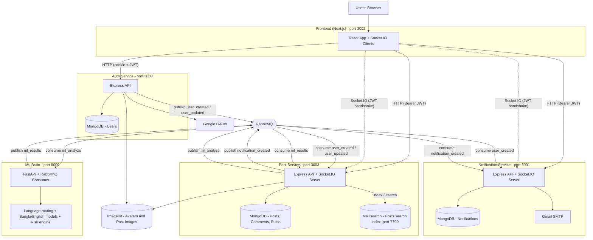
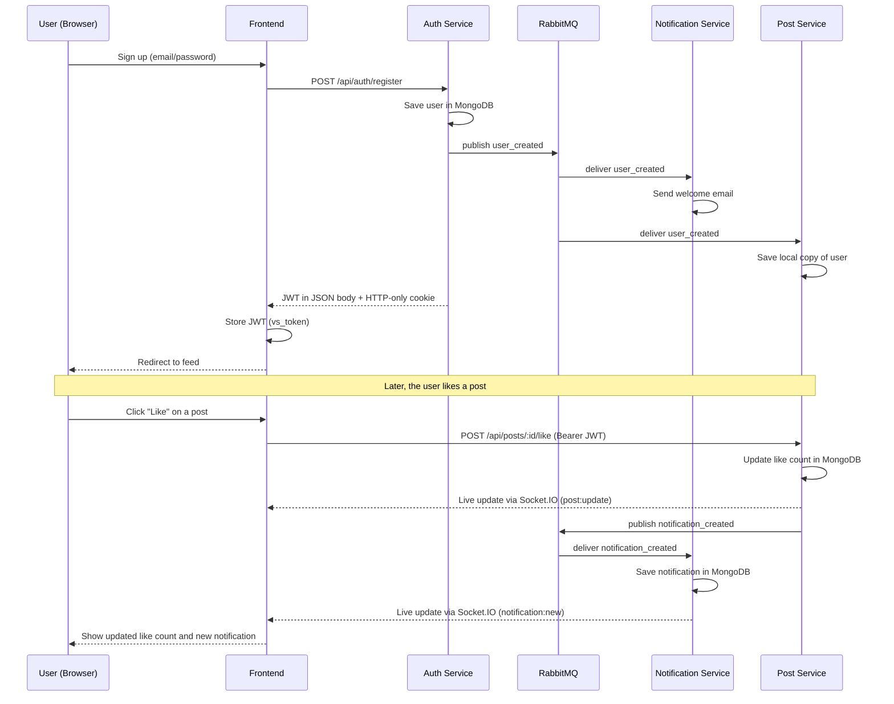
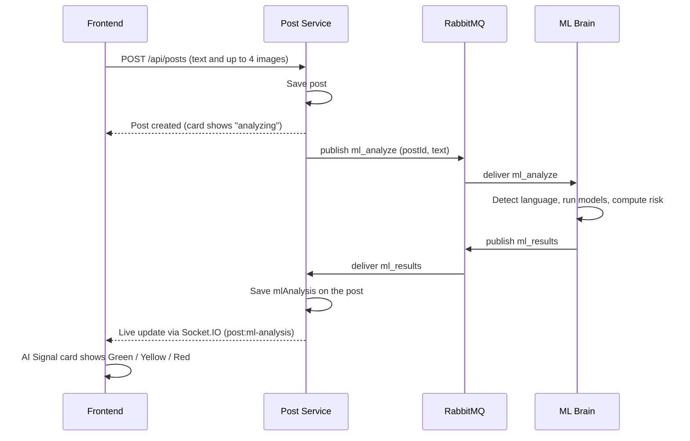

# VerbaScope

VerbaScope is a social platform where people can sign up, build a profile, share posts, follow each other, and interact in real time through likes, comments, shares, bookmarks, and notifications. Every text post is also analyzed by an ML service that returns a Green / Yellow / Red "AI Signal" (language, sentiment, sarcasm, toxicity) to encourage reflection rather than punish users.

The project is built as a set of small backend services (a "microservices" setup) plus one frontend application. Each service has one job, and they talk to each other over HTTP and through a message queue (RabbitMQ). This README gives you the big picture. Each service also has its own README with more detail.

## What's in this project

| Service | What it does | Port |
|---|---|---|
| **Frontend** | The website people actually use: login, feed, profiles, search, bookmarks, live updates | 3002 |
| **Auth Service** | Sign up, login, Google sign-in, user profiles, avatars, and follow/unfollow | 3000 |
| **Notification Service** | Sends emails and delivers in-app notifications in real time | 3001 |
| **Post Service** | Posts, likes, comments, shares, bookmarks, search, and recommendations | 3003 |
| **ML Brain** | Python inference service: language detection, sentiment, sarcasm, toxicity, and the Green/Yellow/Red risk signal | 8000 |

## How it all fits together

1. A user opens the **Frontend** and logs in. The frontend talks to the **Auth Service**, which returns a JWT (also set as an HTTP-only cookie for the auth service itself).
2. The frontend stores the JWT and sends it as an `Authorization: Bearer <token>` header to the **Post** and **Notification** services. These services verify the same JWT independently using the shared `JWT_SECRET`.
3. Once logged in, the frontend loads the feed from the **Post Service**: posts, likes, comments, shares, bookmarks.
4. When a user publishes a text post, the **Post Service** sends it to the **ML Brain** through RabbitMQ. The ML Brain analyzes it and sends the result back, and the Post Service pushes it to the frontend over Socket.IO so the post card's AI Signal updates without a refresh.
5. When something happens that a user should know about (someone liked their post, for example), the **Post Service** tells the **Notification Service** through RabbitMQ, and the **Notification Service** pushes a live update to the frontend using Socket.IO, and/or sends an email.

In short: **Auth** handles "who are you", **Post** handles "what did you post and how did people react", **ML Brain** handles "what does this text signal", and **Notification** handles "let the user know what happened". The **Frontend** ties them together into one app.

## Architecture Diagram



## Data Flow Diagrams

### Sign up and like a post

A user signs up, then later likes someone else's post.



### Publishing a post and the AI Signal



## Tech Stack (shared across the project)

- **Node.js + Express** for the Auth, Post, and Notification services
- **Python + FastAPI + PyTorch/Transformers** for the ML Brain
- **MongoDB + Mongoose** for data storage in the Node services
- **Meilisearch** as a derived full-text search index for posts (MongoDB stays the source of truth)
- **RabbitMQ** for services to send events to each other (e.g. "a new user signed up", "analyze this post")
- **Socket.IO** for real-time updates (likes, comments, AI analysis, notifications) without refreshing the page
- **JWT** for sessions: stored in an HTTP-only cookie by the Auth Service, and also returned in the JSON response so the frontend can send it as a Bearer token to the other services
- **ImageKit** for storing uploaded images (avatars and post photos)
- **Next.js + React + TypeScript** for the frontend

## Project Layout

```
verbascope-social-ml/
├── services/
│   ├── auth-service/         # Sign up, login, profiles, follow/unfollow
│   ├── post-service/         # Posts, likes, comments, shares, bookmarks, search, recommendations
│   ├── notification-service/ # Emails and in-app notifications
│   ├── ml-brain/             # Language routing, sentiment/sarcasm/toxicity, risk signal
│   └── frontend/             # The Next.js website
```

Each folder is its own independent app with its own dependency file (`package.json` or `requirements.txt`) and its own environment file.

## Getting Started

You'll need each service running at the same time for the full app to work. A typical order is:

1. **Start MongoDB and RabbitMQ** locally (or point the `.env` files to hosted versions). The Post Service also needs Meilisearch available for full-text search (default `http://localhost:7700`); see [Full-Text Search System](#-full-text-search-system-meilisearch-integration).
2. **Auth Service**: handles logins, so start this first.
3. **Notification Service**: listens for events like new signups and post activity.
4. **Post Service**: depends on users existing, so start after Auth.
5. **ML Brain**: consumes post-analysis jobs from RabbitMQ. Posts still work without it, but AI Signals won't be produced.
6. **Frontend**: connects to the services above.

For each Node.js service (auth, notification, post):

```bash
cd services/<service-name>
npm install
npm run dev
```

For the frontend (runs on port 3002):

```bash
cd services/frontend
npm install
npm run dev
```

For the ML Brain (Python 3.10+; the first run downloads Hugging Face models, so it can be slow):

```powershell
cd services/ml-brain
python -m venv .venv
.\.venv\Scripts\Activate.ps1
python -m pip install -r requirements.txt
uvicorn main:app --host 0.0.0.0 --port 8000
```

Note that `python main.py` alone does not start the HTTP server; use `uvicorn`. Once everything is running, open the frontend at `http://localhost:3002`.

## Environment Variables

Each service has its own environment file. Here's a quick summary; see each service's README for the full list.

**Auth Service** (`services/auth-service/.env`)
```env
MONGO_URI=your_mongodb_connection_string
JWT_SECRET=your_jwt_secret
JWT_EXPIRES_IN=7d
GOOGLE_CLIENT_ID=your_google_client_id
GOOGLE_CLIENT_SECRET=your_google_client_secret
GOOGLE_CALLBACK_URL=http://localhost:3000/api/auth/google/callback
RABBITMQ_URI=amqp://localhost
IMAGEKIT_PUBLIC_KEY=your_imagekit_public_key
IMAGEKIT_PRIVATE_KEY=your_imagekit_private_key
IMAGEKIT_URL_ENDPOINT=https://ik.imagekit.io/your_instance
CLIENT_URL=http://localhost:3002
```

**Post Service** (`services/post-service/.env`)
```env
MONGO_URI=your_mongodb_connection_string
JWT_SECRET=your_jwt_secret
RABBITMQ_URI=amqp://localhost:5672
PORT=3003
CLIENT_URL=http://localhost:3002
IMAGEKIT_PUBLIC_KEY=your_imagekit_public_key
IMAGEKIT_PRIVATE_KEY=your_imagekit_private_key
IMAGEKIT_URL_ENDPOINT=https://ik.imagekit.io/your_instance
```

**Notification Service** (`services/notification-service/.env`)
```env
MONGO_URI=your_mongodb_connection_string
JWT_SECRET=your_jwt_secret
RABBITMQ_URI=amqp://localhost
EMAIL_USER=your_gmail_address
EMAIL_PASS=your_gmail_app_password
CLIENT_URL=http://localhost:3002
PORT=3001
```

**ML Brain** (`services/ml-brain/.env`)
```env
RABBITMQ_URL=amqp://localhost
```

The ML Brain uses `RABBITMQ_URL` (not `RABBITMQ_URI` like the Node services). Its HTTP port is set by the `uvicorn` command, not by an environment variable.

**Frontend** (`services/frontend/.env.local`)
```env
NEXT_PUBLIC_AUTH_API_URL=http://localhost:3000
NEXT_PUBLIC_AUTH_URL=http://localhost:3000
NEXT_PUBLIC_NOTIFICATION_API_URL=http://localhost:3001
NEXT_PUBLIC_POST_API_URL=http://localhost:3003
NEXT_PUBLIC_API_URL=http://localhost:3003
NEXT_PUBLIC_IMAGEKIT_PUBLIC_KEY=your_imagekit_public_key
NEXT_PUBLIC_IMAGEKIT_URL_ENDPOINT=https://ik.imagekit.io/your_instance
```

> **Important:** The `JWT_SECRET` value must be the same across the Auth, Post, and Notification services. Each service verifies the same JWT on its own, which is how one login works across all of them.

## Core Features

- **Accounts:** Email/password sign up and login, plus Google sign-in
- **Profiles:** Bio, headline, avatar uploads, and viewing other users' profiles
- **Social graph:** Follow and unfollow other users
- **Posts:** Create posts with up to 4 images, view a feed, view posts by user, and open a post detail page
- **Engagement:** Like, comment (with threaded replies), share (with a reason), and bookmark posts
- **Search:** Fast, typo-tolerant full-text search over posts and tags from the navbar (powered by Meilisearch), with tag pages and a full search page (people search is not implemented yet)
- **Recommendations:** Suggested users to follow based on shared interests, plus trending hashtags and weekly pulse topics
- **AI Signal:** Each text post gets a Green / Yellow / Red signal with a short explanation and details such as language, sentiment, sarcasm, toxicity level, and confidence. Bangla and English are supported. The signal is guidance for reflection; it does not delete posts or penalize accounts.
- **Notifications:** Real-time in-app notifications and welcome emails
- **Live updates:** New likes, comments, shares, AI analysis results, and notifications appear instantly without a page refresh
- **Theme:** Light/dark theme resolved on the server to avoid a flash on first load

## How the services talk to each other

- **HTTP requests:** the frontend calls each backend service directly for things like logging in, loading the feed, or updating a profile. The Auth Service's own protected endpoints use its HTTP-only cookie; the Post and Notification services accept the Bearer token (and fall back to the cookie).
- **RabbitMQ (events):** backend services notify each other when something important happens, without waiting on each other directly:
  - Auth Service publishes `user_created` on sign up (and on each Google sign-in callback) and `user_updated` after profile or avatar changes.
  - Notification Service listens for `user_created` and sends a welcome email (or a Google data-sharing notice for Google accounts).
  - Post Service listens for user events so it can keep a local copy of user info for the feed.
  - Post Service publishes `notification_created` for likes, comments, and shares; the Notification Service stores it and delivers it live.
  - Post Service publishes `ml_analyze` jobs; the ML Brain consumes them and publishes results to `ml_results`, which the Post Service consumes.
- **Socket.IO (real-time):** the Post and Notification services push live updates straight to the browser. The client authenticates the handshake with its JWT, and the server places it in a room based on the verified user ID. Events include `post:update`, `post:deleted`, `post:ml-analysis`, `pulse:update` (Post Service) and `notification:new` (Notification Service).

### 🔍 Full-Text Search System (Meilisearch Integration)

VerbaScope uses **Meilisearch** as a derived full-text search index alongside MongoDB. It provides sub-50ms query execution, typo tolerance, and prefix matching across post text, hashtags, author names, and user avatars.

The default port for Meilisearch in this project's setup is **7700** (running at `http://localhost:7700`).

#### Architecture & Design Principles

- **Source of Truth:** MongoDB remains the primary database. Meilisearch is an ephemeral, disposable index that can be safely wiped and rebuilt from MongoDB at any time.
- **Non-Blocking / Fire-and-Forget:** Post creation and deletion update MongoDB first, then asynchronously index or delete documents in Meilisearch without delaying HTTP responses.
- **Self-Healing on Cloud Restarts:** On platforms with ephemeral filesystems (e.g., Render), container restarts wipe local disk storage (`data.ms`). On startup (`server.js`), the service checks `postsIndex().getStats()`. If the document count is `0`, it automatically runs `rebuildSearchIndex()` to restore the search index from MongoDB.

#### Core Search Modules (`services/post-service/src/search/`)

| File | Responsibility |
| :--- | :--- |
| `meiliClient.js` | Initializes the Meilisearch SDK client and ensures the primary `"posts"` index exists (`primaryKey: "_id"`). |
| `postIndex.js` | Formats post documents (`content`, `tags`, `authorName`, `authorAvatar`, `createdAt`) and exports `indexPost()`, `deleteIndexedPost()`, `searchPosts()`, and `rebuildSearchIndex()`. |
| `searchHealth.js` | Helper function for checking Meilisearch connection status. |
| `../scripts/reindexPosts.js` | Standalone CLI script to backfill or re-index existing MongoDB posts into Meilisearch. |

#### API Endpoints

| Method | Endpoint | Auth | Description |
| :--- | :--- | :--- | :--- |
| `GET` | `/api/posts/search/health` | Public | Returns `{ status: "ok", meilisearch: "available" }`. |
| `GET` | `/api/posts/search?q=<query>` | _TODO_ | Full-text post search. _(Details to be completed; see the Post Service README.)_ |

## A Note on Local Development

This project is set up for local development first. A few things to keep in mind:

- If RabbitMQ isn't running, most Node services will still start, but real-time, notification, and AI Signal features will be limited. The Notification Service retries its RabbitMQ connection, but the ML Brain's queue consumer does **not** reconnect automatically: if its connection drops, restart the ML Brain to resume queue processing.
- RabbitMQ messages that fail processing are not automatically retried in the Notification Service or the ML Brain (there is no dead-letter handling yet).
- The ML Brain loads all of its models at startup, so it takes time and memory to start, and its first run needs network access to download the models.
- The frontend currently disables image optimization and ignores TypeScript build errors to make local development smoother. This should be revisited before a production deployment.
- Logout clears cookies and the stored token, but JWTs are not revoked; a copied token stays valid until it expires (7 days by default).
- Each service should be started separately, and MongoDB and RabbitMQ should be available before starting the backend services.

## Known Limitations

- Notification Service: reply activity is sent as `type: "reply"`, but the notification model only allows `like`, `comment`, and `share`, so reply notifications are currently not saved. Share notifications also fall back to generic message text.
- ML Brain: English sentiment is currently a constant `Neutral` placeholder. The evaluation script and some scripts in `tests/` still reference older APIs, so no current benchmark numbers should be quoted from the checked-in `results.csv`.
- Frontend: no `/explore` page exists, the "Forgot?" password link has no flow behind it, the login "remember me" option has no effect, and only `/feed`, bookmarks, and post detail pages redirect unauthenticated visitors. Real authorization is always enforced by the backend APIs.
- The Notification Service's `POST /api/notification/test-email` endpoint is unauthenticated; restrict or remove it before any public deployment.
- Auth Service: the bulk user lookup endpoints (`/api/users/bulk`) do not require authentication.