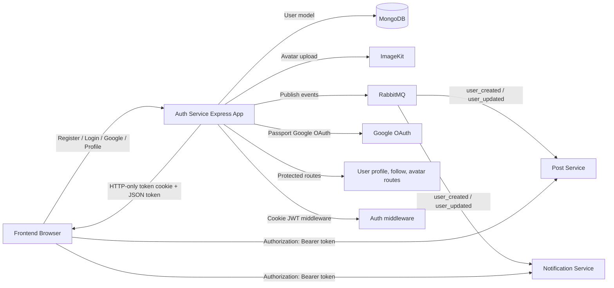

# Auth Service

This service is the authentication and user-profile backbone for the VerbaScope platform. It handles user sign-up, login, JWT-based session management, Google OAuth authentication, avatar uploads, follow relationships, and user-profile syncing to downstream services through RabbitMQ.

## What this service does

- Registers and authenticates users using email/password
- Issues signed JWTs in both an HTTP-only `token` cookie and the register/login JSON response
- Supports Google OAuth login and account linking
- Returns the authenticated user profile and manages protected profile updates
- Supports follow/unfollow actions and social graph lookups
- Uploads user avatars to ImageKit, validates image uploads, and cleans up old avatars
- Publishes `user_created` and `user_updated` events through RabbitMQ so downstream services can sync user data
- Provides the JWT used by the frontend as a Bearer token when calling other services

## Architecture Diagram



The auth-service API uses its HTTP-only cookie for its own protected endpoints. The JSON token is also stored by the frontend and sent to the post and notification services in an `Authorization: Bearer <token>` header. Those services verify the JWT independently; their separate Render hostnames cannot receive the auth-service cookie.

## Tech stack

- Node.js + Express
- MongoDB + Mongoose
- JWT + Passport.js
- RabbitMQ via amqplib
- Multer + ImageKit for avatar handling
- dotenv, cookie-parser, cors, morgan

## Project files and their purpose

### Root files

- package.json: Defines the service dependencies and scripts (`npm run dev` and `npm start`). The `test` script is currently a placeholder that exits with an error because no tests are configured.
- server.js: Connects to MongoDB and RabbitMQ, mounts authentication and user routes, and starts the Express server on port 3000.
- README.md: Service documentation and module overview.

### Application setup

- src/app.js: Creates the Express app, enables CORS, JSON parsing, cookie parsing, request logging, and Passport initialization.

### Configuration and environment

- src/config/config.js: Loads environment variables and exposes configuration values for MongoDB, JWT, Google OAuth, RabbitMQ, and ImageKit.
- src/config/passport.js: Configures the Google OAuth strategy, creates or links users from Google sign-in, and returns authentication info to the controller.

### Database and messaging

- src/db/db.js: Connects the service to MongoDB using Mongoose and returns a success/failure boolean.
- src/broker/rabbit.js: Opens a RabbitMQ connection/channel and exposes publishing helpers for sending events such as user_created and user_updated.

### Routes

- src/routes/auth.routes.js: Defines the public authentication endpoints for register, login, Google OAuth, user profile retrieval, and logout.
- src/routes/user.routes.js: Defines protected routes for profile viewing, profile editing, avatar updates, follow/unfollow actions, and bulk user lookup.

### Controllers

- src/controller/auth.controller.js: Implements validated registration/login, password hashing and verification, JWT issuance, Google OAuth callback handling, current-user lookup, logout, and `user_created` publishing.
- src/controller/user.controller.js: Implements authenticated profile lookup and updates, avatar uploading, follow/unfollow actions, following-list retrieval, bulk user fetching, and `user_updated` publishing.
- src/controller/auth.controller.js.bak: Backup of an earlier controller; it is not imported by the running service.

### Middleware

- src/middlewares/auth.middleware.js: Verifies the JWT from the `token` cookie and attaches its decoded payload to `req.user`. This middleware does not currently read an Authorization Bearer header.
- src/middlewares/validation.middleware.js: Validates login and registration payloads using express-validator before controller execution.
- src/middlewares/avatarUpload.middleware.js: Accepts one multipart `avatar` image in memory, allows JPEG/PNG/WEBP/GIF up to 5 MB, and formats upload errors as JSON responses.

### Data model

- src/model/user.model.js: Defines the Mongoose user schema with fields for email, fullname, password, Google ID, role, bio, headline, avatar, followers, following, and interests.

### Utilities

- src/utils/imagekit.js: Uploads avatar images to ImageKit and removes previously uploaded avatars for the same user after a replacement upload.

### Scripts

- src/scripts/backfillUserUpdated.js: One-off maintenance script that re-publishes user_updated events for all existing users so downstream services can sync profile changes.

## API overview

### Authentication endpoints

- POST /api/auth/register
  - Validates and creates a user, hashes the password, issues an HTTP-only cookie, and returns the JWT in the response body
- POST /api/auth/login
  - Verifies the email/password, issues an HTTP-only cookie, and returns the JWT in the response body
- GET /api/auth/google
  - Starts the Google OAuth sign-in flow
- GET /api/auth/google/callback
  - Completes Google OAuth authentication, issues a cookie, publishes a user event, and redirects to the client with a `token` query parameter
- GET /api/auth/me
  - Returns the currently authenticated user profile; requires the auth-service `token` cookie
- POST /api/auth/logout
  - Requires the auth-service `token` cookie and clears it. The frontend also removes its locally stored Bearer token.

### User endpoints

- GET /api/users/:id
  - Returns a profile summary for a user, or the current user when `id` is `me`; requires the auth-service `token` cookie
- PATCH /api/users/profile
  - Updates profile fields such as bio, headline, and names; optionally accepts an `avatar` file in the same multipart request; requires the auth-service `token` cookie
- PATCH /api/users/avatar
  - Uploads a new avatar image for the current user; requires the auth-service `token` cookie
- POST /api/users/follow/:id
  - Follows another user; requires the auth-service `token` cookie
- POST /api/users/unfollow/:id
  - Unfollows another user; requires the auth-service `token` cookie
- GET /api/users/me/following
  - Returns the list of users the current user is following; requires the auth-service `token` cookie
- GET /api/users/bulk and POST /api/users/bulk
  - Return user summaries for a provided list of IDs; these routes do not use the authentication middleware

## Environment variables

Create a `.env` file in the service root. Use the same strong `JWT_SECRET` in services that verify auth-service tokens. `JWT_EXPIRES_IN` is optional and defaults to `7d`.

```env
MONGO_URI=your_mongodb_connection_string
JWT_SECRET=your_jwt_secret
JWT_EXPIRES_IN=7d
GOOGLE_CLIENT_ID=your_google_client_id
GOOGLE_CLIENT_SECRET=your_google_client_secret
GOOGLE_CALLBACK_URL=http://localhost:3000/api/auth/google/callback
RABBITMQ_URI=amqp://localhost
IMAGEKIT_PUBLIC_KEY=your_imagekit_public_key
IMAGEKIT_PRIVATE_KEY=your_imagekit_private_key
IMAGEKIT_URL_ENDPOINT=https://ik.imagekit.io/your_instance
CLIENT_URL=http://localhost:3002
```

`CLIENT_URL` is also used as an allowed CORS origin. Google credentials can alternatively be supplied as `CLIENT_ID` and `CLIENT_SECRET`. ImageKit credentials are needed for avatar uploads, and Google credentials are needed for Google sign-in.

## Installation and run

```bash
npm install
npm run dev
```

For production:

```bash
npm start
```

The service listens on port 3000.

## Notes

- Auth-service protected routes use the JWT in the HTTP-only `token` cookie. Register and login also return the token in JSON for the frontend's cross-service Bearer-token requests.
- The frontend helper is exported as `tokenStorage` from `services/frontend/lib/api.ts` (there is no separate `tokenStorage.ts` file). The API client's request interceptor adds `Authorization: Bearer <token>`; browser requests still need to pass the configured CORS checks.
- Google OAuth redirects to the frontend with `?token=...`; the feed page reads and stores this token. Query-string tokens can appear in browser history or logs, so production deployments should use HTTPS and avoid logging redirect URLs containing tokens.
- Google OAuth users are created automatically when no matching account exists.
- User creation and profile/avatar updates publish events to RabbitMQ so downstream services can stay in sync. The one-off backfill script can republish `user_updated` for existing users.
- Avatar uploads are held in memory during the request and stored in ImageKit rather than on local disk.
- `ProtectedRoute` redirects unauthenticated visitors from `/feed` and its nested paths after the frontend checks session state through `/api/auth/me`. Other protected API endpoints must still verify the JWT server-side; hiding or redirecting a frontend page alone is not an authorization boundary.

## Interview Questions

### 🔑 2. Auth Service & Service-to-Service Security: "How did you connect services with Bearer Tokens and protect pages?"

**Answer:** Register and login sign a JWT containing the user's `id` (with an expiry of seven days by default). Auth-service sets it as an HTTP-only `token` cookie for its own browser-facing endpoints and also returns it in the JSON response. The frontend stores that response token as `vs_token` in local storage through the `tokenStorage` helper in `lib/api.ts`. Its shared Axios request interceptor adds `Authorization: Bearer <token>` to API calls, allowing post-service and notification-service to verify the same JWT even though they run on separate service hostnames and cannot receive auth-service's cookie. Google OAuth similarly sets the cookie and passes a token to the frontend in the redirect query string, which the feed page stores.

**Page and API protection:** The frontend `AuthProvider` checks the session using `GET /api/auth/me`; `ProtectedRoute` redirects unauthenticated visitors away from `/feed` and its nested paths. API routes are protected separately: auth-service currently validates its cookie in `auth.middleware.js`, while post-service and notification-service accept the Bearer header and fall back to the cookie. CORS still applies to browser requests; Bearer tokens solve cookie-sharing across these service hosts, not CORS itself.

**Why Bearer tokens instead of relying only on cookies?** The frontend needs to call multiple services hosted on different registrable domains (for example, separate `*.onrender.com` hosts). A cookie scoped to the auth-service host is not shared with those other hosts. The frontend can instead explicitly attach the JWT to each request in the Authorization header. This also means the frontend's local-storage token is accessible to JavaScript, so XSS prevention and HTTPS remain important.

### 3. "How does Google OAuth handle existing accounts?"

**Answer:** Passport's Google strategy looks for a user by Google ID or email. If it finds an email account without a Google ID, it links the Google ID to that account; otherwise it creates a new Google-backed user. The callback signs a JWT, sets the auth cookie, publishes a `user_created` event, and redirects to the frontend.

### 4. "How are passwords and registration input handled?"

**Answer:** Express-validator checks email format, non-empty names, and a minimum password length of six characters. Registration hashes the password with bcryptjs using a cost factor of 10 before saving it. Login compares the submitted password with the stored hash, and user responses omit the password field.

### 5. "How do other services keep user profile data current?"

**Answer:** Auth-service publishes JSON `user_created` events on local registration and on every successful Google OAuth callback, and `user_updated` events after profile/avatar updates. Post-service and notification-service consume user events for their local user data and notification behavior. `backfillUserUpdated.js` is a one-off script to republish current user IDs, names, and avatars for existing users.

### 6. "How do avatar uploads work, and what happens if an old-image cleanup fails?"

**Answer:** Multer keeps one allowed image (JPEG, PNG, WEBP, or GIF; at most 5 MB) in memory. The controller uploads its buffer to ImageKit and stores the returned URL on the user. Only after a successful upload does it attempt to delete previous avatar files for that user; cleanup failures are logged and do not invalidate the newly saved avatar.

### 7. "What does logout do, and are JWTs revoked immediately?"

**Answer:** Logout clears the auth-service cookie, and the frontend removes `vs_token` from local storage and clears its in-memory user state. The service does not implement a token revocation list or refresh-token endpoint, so a copied JWT remains cryptographically valid until its expiry; clearing a browser's copy does not invalidate another copy.
