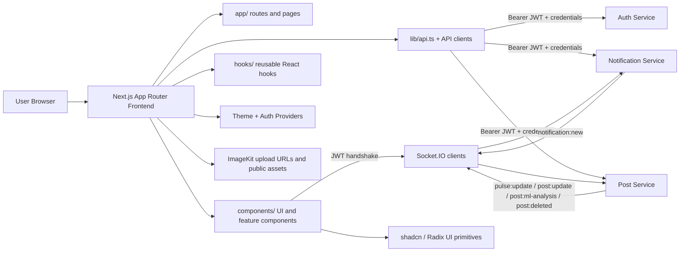

# VerbaScope Frontend

This directory contains the VerbaScope web application. It is a Next.js App Router frontend with React, TypeScript, Axios, Socket.IO, a server-initialized light/dark theme, and reusable UI primitives. It provides authentication, the social feed, profiles, search, post details, bookmarks, comments, notifications, and real-time pulse and post updates.

## Architecture Diagram



## Project Structure

```text
frontend/
├── app/                 # Next.js routes and page-level styles
├── components/          # Shared, feature, profile, search, and UI components
├── hooks/               # Reusable React hooks
├── lib/                 # API clients and utilities
├── public/              # Static image and icon assets
├── styles/              # Additional CSS variable stylesheet
├── types/               # Shared TypeScript types
├── components.json      # shadcn configuration
├── next.config.mjs      # Next.js configuration
├── next-env.d.ts        # Generated Next.js type references
├── package.json         # Scripts and dependencies
├── package-lock.json    # npm lockfile
├── pnpm-lock.yaml       # pnpm lockfile
├── postcss.config.mjs   # PostCSS configuration
├── tsconfig.json        # TypeScript configuration
├── feed_classes.txt     # Extracted feed CSS selector inventory
├── feed_sorted.txt      # Sorted feed CSS selector inventory
├── globals_classes.txt  # Extracted global CSS selector inventory
├── globals_sorted.txt   # Sorted global CSS selector inventory
├── tscout.txt           # Checked-in TypeScript diagnostic snapshot
└── README.md
```

## Root Files And Folders

| Path | Purpose |
| --- | --- |
| `package.json` | Defines the `verbascope-frontend` package, Next.js scripts, and runtime/development dependencies. |
| `package-lock.json` | npm lockfile. It may not exactly match the package ranges currently declared in `package.json`. |
| `pnpm-lock.yaml` | pnpm lockfile containing a second resolved dependency tree. Choose one package manager for a deployment rather than mixing lockfiles. |
| `next.config.mjs` | Configures Next.js to use webpack, disable image optimization, and ignore TypeScript build errors. |
| `tsconfig.json` | Enables strict TypeScript, bundler module resolution, the Next plugin, and the `@/*` path alias. |
| `components.json` | shadcn configuration: New York style, Lucide icons, CSS variables, and project path aliases. |
| `postcss.config.mjs` | Empty PostCSS plugin configuration. |
| `next-env.d.ts` | Generated Next.js type references and generated route-type import. Do not edit manually. |
| `.gitignore` | Excludes local environment files, `node_modules`, `.next`, Vercel/v0 artifacts, and other generated files. |
| `.env.local` | Local environment configuration. Values are intentionally not documented; keep credentials out of source control. |
| `feed_classes.txt` | Generated/extracted list of CSS selectors found in feed styles. |
| `feed_sorted.txt` | Sorted version of the feed selector inventory. |
| `globals_classes.txt` | Generated/extracted list of global CSS selectors. |
| `globals_sorted.txt` | Sorted version of the global selector inventory. |
| `tscout.txt` | Stored TypeScript diagnostic snapshot; it is not an executable test suite and may become stale. |
| `node_modules/` | Generated installed dependencies. |
| `.next/` | Generated Next.js build and development output, caches, manifests, bundles, and route types. |
| `README.md` | This documentation. |

## App Router Pages And Styles

### Root and authentication

| Path | Purpose |
| --- | --- |
| `app/layout.tsx` | Root layout. Defines metadata, loads Google fonts, resolves the `vs-theme` cookie on the server, and wraps the application with `ThemeProvider`, `AuthProvider`, and `ProtectedRoute`. |
| `app/page.tsx` | Public landing page. Redirects authenticated users to `/feed` and displays the product hero, calls to action, feature highlights, and sample post visual. |
| `app/globals.css` | Main design system: light/dark tokens, typography, reset rules, buttons, inputs, cards, badges, navigation, decorations, and animations. |
| `app/home.css` | Landing-page gradient, hero, feature grid, CTA, visual card, animated decorations, and responsive rules. |
| `app/auth/login/page.tsx` | Email/password login, client validation, remember-me control, Google OAuth link, and registration link. |
| `app/auth/register/page.tsx` | Registration form for first name, last name, email, password, validation, and Google OAuth. |
| `app/auth/auth.css` | Shared authentication split layout, branding, form controls, alerts, buttons, and responsive behavior. |

### Feed and content pages

| Path | Purpose |
| --- | --- |
| `app/feed/page.tsx` | Client-loaded authenticated feed. Fetches ten posts per page, appends more using an intersection observer, handles Community Insights and AI-risk filters, optimistic interaction updates, post creation/deletion, comments, and loading/error states. |
| `app/feed/feed.css` | Feed grid, post/sidebar layout, media carousels, comments, pagination, empty states, share sheet, and responsive rules. |
| `app/feed/MobileTrendingBar.tsx` | Horizontal mobile trending-tag chips with fallback content. |
| `app/feed/WhoToFollowInline.tsx` | Mobile recommendations block with follow/unfollow actions and profile links. |
| `app/bookmarks/page.tsx` | Authenticated paginated saved-post view with post interactions. |
| `app/bookmarks/BookmarkSkeleton.tsx` | Loading placeholders for the bookmarks page. |
| `app/post/[id]/page.tsx` | Authenticated post detail page with comments open initially, sharing, bookmarking, deletion, copy-link, and navigation. |
| `app/post/[id]/post-page.css` | Post-detail shell, sticky header, loading state, and not-found state. |
| `app/profile/[id]/page.tsx` | Profile page shell with posts/saved tabs, profile header, and owner logout. |
| `app/profile/[id]/profile-page.css` | Responsive profile two-column and sidebar layout. |
| `app/search/page.tsx` | Search page with query-string synchronization, pagination/load-more, result metadata, loading, error, and empty states. |
| `app/search/search.css` | Search page styling and dark-theme overrides. |
| `app/tag/[tag]/page.tsx` | Tag-specific post listing with incremental loading and error handling. |

There is currently no `app/explore/page.tsx`; any navigation link to `/explore` therefore does not have a matching App Router page.

The landing page is public. `/feed` is guarded by `ProtectedRoute`; bookmarks and post details perform their own redirect checks. Profile, search, and tag pages currently fetch independently and are not covered by the central route guard.

## Shared Components

| Path | Purpose |
| --- | --- |
| `components/auth-provider.tsx` | Auth context. Hydrates `/api/auth/me` and exposes login, registration, Google login, logout, and user-state update operations; stores issued JWTs for cross-service calls. |
| `components/ProtectedRoute.tsx` | Guards `/feed` and nested feed paths and shows the full feed skeleton while authentication loads. |
| `components/theme-provider.tsx` | Starts from the theme resolved by the server and synchronizes React state, the `<html data-theme>` attribute, localStorage, and the `vs-theme` cookie. |
| `components/ThemeToggle.tsx` | Accessible light/dark sliding switch. |
| `components/ThemeToggle.css` | Theme switch styling. |
| `components/Navbar.tsx` | Main navigation, search, theme toggle, notifications, Socket.IO notification updates, mobile menu, profile link, and logout. |
| `components/Navbar.css` | Navigation styling and responsive mobile menu rules. |
| `components/CreatePostBox.tsx` | Multipart post composer with up to four image previews, a 3,000-character content guard, cancellation, and a parent callback for immediate feed insertion. |
| `components/CreatePostBox.css` | Composer, upload preview, and form styling. |
| `components/FeedSkeleton.tsx` | Feed and sidebar shimmer placeholders. |
| `components/FeedSkeleton.css` | Feed skeleton styling. |
| `components/SidebarSkeleton.tsx` | Sidebar-specific skeleton composition. |

### `components/feed/`

| Path | Purpose |
| --- | --- |
| `PostCard.tsx` | Renders authors, avatars, media carousel, tags, actions, dwell tracking, comments, and owner menu. |
| `PostCard.css` | Post card, media, action, and legacy comment styles. |
| `CommentSection.tsx` | Comment input/list and real-time discussion mood/pulse card. |
| `CommentSection.css` | Comment input and sentiment pulse styles. |
| `CommentThread.tsx` | Recursive replies, reply creation/deletion, sentiment badge, avatars, and profile links. |
| `CommentThread.css` | Thread indentation, reply controls, avatar, and sentiment styles. |
| `ShareSheet.tsx` | Share-reason modal sheet. |
| `PostMoreMenu.tsx` | Owner-only post deletion menu. |
| `AISignalCard.tsx` | Displays an analyzing/unavailable state or the risk badge and signal message; its expanded view includes language, sentiment, sarcasm, toxicity level, and confidence. |
| `Sidebar.tsx` | Weekly pulse topics, Community Insights, recommendations, and follow/unfollow controls. |
| `LikeAnimation.tsx` | Portal-based remote DotLottie like animation with a timeout fallback. |
| `icons.tsx` | Inline SVG heart, comment, share, bookmark, globe, send, and chevron icons. |
| `feedHelpers.ts` | Safe author formatting, avatar fallback/color helpers, relative time, and hashtag extraction. |
| `useFeedSocket.ts` | Connects to post-service Socket.IO with the stored JWT; applies weekly pulse updates, post counters, ML analysis, and post deletions to feed state. |

### `components/profile/`

| Path | Purpose |
| --- | --- |
| `ProfileHeader.tsx` | Fetches profile data and supports avatar upload, profile editing, follow/unfollow, counts, loading, and empty states. |
| `ProfileHeader.css` | Cover, avatar, identity, edit fields, statistics, skeleton, and responsive styling. |
| `ProfilePosts.tsx` | Loads user/saved posts and handles comments, likes, deletion, retry, and empty states. |
| `ProfilePosts.css` | Profile post list and state styling. |
| `ProfileTabs.tsx` | Posts and owner-only Saved tabs, with embedded styled JSX. |

### `components/search/`

| Path | Purpose |
| --- | --- |
| `SearchBar.tsx` | Debounced search input with keyboard navigation, post/tag routing, and result dropdown. |
| `SearchBar.css` | Navbar search and dropdown styling, including dark mode. |
| `SearchDropdown.tsx` | Loading, error, empty, post-result, tag-result, and “view all” states. |
| `SearchResultItem.tsx` | Search post result with author link, avatar fallback, and relative time. |
| `TagResultItem.tsx` | Tag result row with count and hash icon. |

## `components/ui/` Primitives

This folder contains reusable shadcn/Radix-style primitives. Several are scaffolded for future use and are not imported by the application-specific pages.

| File | Primitive |
| --- | --- |
| `accordion.tsx` | Accordion |
| `alert-dialog.tsx` | Confirmation alert dialog |
| `alert.tsx` | Alert, title, and description |
| `aspect-ratio.tsx` | Aspect-ratio wrapper |
| `avatar.tsx` | Avatar image and fallback |
| `badge.tsx` | CVA badge variants |
| `breadcrumb.tsx` | Breadcrumb navigation |
| `button-group.tsx` | Grouped buttons and separators |
| `button.tsx` | CVA button variants and sizes |
| `calendar.tsx` | `react-day-picker` calendar |
| `carousel.tsx` | Embla carousel context and controls |
| `chart.tsx` | Recharts container, tooltip, legend, and theme styles |
| `checkbox.tsx` | Radix checkbox |
| `collapsible.tsx` | Collapsible root, trigger, and content |
| `command.tsx` | cmdk command palette |
| `context-menu.tsx` | Context menu primitives and item variants |
| `dialog.tsx` | Dialog root, portal, overlay, content, and headings |
| `drawer.tsx` | Vaul drawer primitives |
| `dropdown-menu.tsx` | Dropdown, checkbox, radio, submenu, and item primitives |
| `empty.tsx` | Empty-state layout primitives |
| `field.tsx` | Form fields, labels, descriptions, errors, and separators |
| `form.tsx` | React Hook Form integration |
| `hover-card.tsx` | Hover card |
| `input-group.tsx` | Input, textarea, addon, and button group |
| `input-otp.tsx` | OTP input and slots |
| `input.tsx` | Styled text input |
| `item.tsx` | Generic item/list primitives |
| `kbd.tsx` | Keyboard shortcut display |
| `label.tsx` | Radix label |
| `menubar.tsx` | Menubar and submenu |
| `navigation-menu.tsx` | Navigation menu and viewport |
| `pagination.tsx` | Pagination primitives |
| `popover.tsx` | Popover root, content, and anchor |
| `progress.tsx` | Progress bar |
| `radio-group.tsx` | Radio group and item |
| `resizable.tsx` | Resizable panel group and handle |
| `scroll-area.tsx` | Scroll area and scrollbar |
| `select.tsx` | Select root, trigger, content, items, labels, and separators |
| `separator.tsx` | Horizontal/vertical separator |
| `sheet.tsx` | Side sheet based on Radix Dialog |
| `sidebar.tsx` | Responsive collapsible sidebar with cookie persistence and keyboard shortcut |
| `skeleton.tsx` | Generic loading pulse |
| `slider.tsx` | Radix slider |
| `sonner.tsx` | Sonner toaster adapter using next-themes |
| `spinner.tsx` | Lucide loading spinner |
| `switch.tsx` | Radix switch |
| `table.tsx` | Table primitives |
| `tabs.tsx` | Radix tabs |
| `textarea.tsx` | Styled textarea |
| `toast.tsx` | Radix toast primitives and variants |
| `toaster.tsx` | Toast renderer |
| `toggle-group.tsx` | Toggle group |
| `toggle.tsx` | Toggle variants and primitive |
| `tooltip.tsx` | Tooltip provider, trigger, and content |
| `use-mobile.tsx` | 768px mobile media-query hook |
| `use-toast.ts` | Duplicate toast state/reducer implementation |

## Hooks

| Path | Purpose |
| --- | --- |
| `hooks/useAuth.ts` | Typed wrapper around the auth context. |
| `hooks/useDwellTracker.ts` | Sends a dwell event after at least three seconds when at least 50% of a post is visible. |
| `hooks/useSearch.ts` | Debounces post/tag searches by 300 ms, aborts superseded requests, and maintains dropdown loading/error/results state. |
| `hooks/useTheme.ts` | Theme context accessor. |
| `hooks/use-mobile.ts` | Generic mobile media-query hook. |
| `hooks/use-toast.ts` | Toast reducer and state implementation. |

## API Clients, Utilities, And Types

| Path | Purpose |
| --- | --- |
| `lib/api.ts` | Axios client abstraction plus auth, user, notification, post, recommendation, bookmark, comment, dwell, and post-search services. Browser requests include credentials and attach the locally stored JWT as a Bearer header when present. |
| `lib/api/posts.ts` | Re-exports `postApi` and `postService`. |
| `lib/api/search.ts` | Fetch-based post/tag search and tag-post client; consumes `NEXT_PUBLIC_API_URL` and attaches the stored Bearer token. Navbar post search uses Axios while its tag suggestions use this fetch client. |
| `lib/utils.ts` | `cn` helper built with `clsx` and `tailwind-merge`. |
| `types/index.ts` | User, auth, form, ML signal, post, follower, and API error types. |
| `types/search.ts` | Search post, tag, and response types. |

## Styling And Assets

| Path | Purpose |
| --- | --- |
| `styles/globals.css` | Additional Tailwind/shadcn variables and base styles. The root layout imports `app/globals.css`; this separate stylesheet is not the root global stylesheet. |
| `public/favicon.jpg` | Dark VerbaScope V logo. |
| `public/favicon.svg` | Teal/dark V logo SVG. |
| `public/placeholder.jpg` | Blank placeholder image. |
| `public/placeholder-user.jpg` | Generic user silhouette. |
| `public/placeholder.svg` | Generic image placeholder SVG. |

Uploaded post and avatar previews use browser blob URLs and backend-returned external URLs. The like animation loads a remote Lottie asset from `lottie.host`. Root metadata currently points to `favicon.jpg` while declaring an SVG MIME type. The placeholder assets are not imported by authored source files.

## Environment Variables

The frontend source or local environment references these names:

| Variable | Used for |
| --- | --- |
| `NEXT_PUBLIC_AUTH_API_URL` | Auth API base URL. |
| `NEXT_PUBLIC_AUTH_URL` | Auth URL used by auth flows. |
| `NEXT_PUBLIC_NOTIFICATION_API_URL` | Notification API base URL. |
| `NEXT_PUBLIC_POST_API_URL` | Post-service API base URL. |
| `NEXT_PUBLIC_API_URL` | Generic API base URL used by the search client. |
| `NEXT_PUBLIC_IMAGEKIT_PUBLIC_KEY` | ImageKit browser upload configuration. |
| `NEXT_PUBLIC_IMAGEKIT_URL_ENDPOINT` | ImageKit public URL endpoint. |

Defaults used by the API clients are auth `http://localhost:3000`, notification `http://localhost:3001`, post `http://localhost:3003`, and generic search `http://localhost:3003`. The post and notification Socket.IO URLs use `NEXT_PUBLIC_POST_API_URL` and `NEXT_PUBLIC_NOTIFICATION_API_URL` respectively, with the same localhost defaults. Keep `.env.local` private.

## Running The Frontend

From `services/frontend`:

```powershell
npm install
npm run dev
```

The development server runs on port `3002`. Open `http://localhost:3002` after the server starts.

Available npm scripts:

| Command | Behavior |
| --- | --- |
| `npm run dev` | Runs `next dev --webpack -p 3002`. |
| `npm run build` | Runs `next build --webpack`. |
| `npm start` | Runs `next start -p 3002`. |
| `npm run lint` | Runs `next lint`; this may be incompatible with newer Next.js versions because no separate ESLint setup is configured. |

The repository also includes a pnpm lockfile, so the equivalent commands are `pnpm install`, `pnpm dev`, `pnpm build`, `pnpm start`, and `pnpm lint`. Use one package manager consistently.

## Dependencies

The declared application dependencies include Next.js, React, React DOM, Axios, Socket.IO Client, Lucide React, and `@lottiefiles/dotlottie-react`. Development dependencies include TypeScript and the Node/React type packages.

The UI primitives additionally import packages that are not all declared in `package.json`, including Radix UI packages, `class-variance-authority`, `clsx`, `tailwind-merge`, `react-day-picker`, `embla-carousel-react`, `recharts`, `cmdk`, `vaul`, `react-hook-form`, `input-otp`, `react-resizable-panels`, `next-themes`, `sonner`, and Tailwind-related packages. A clean install may therefore fail when importing unused primitives until these dependencies are declared or those files are removed.

## Authentication And Runtime Behavior

Authentication is provided by `AuthProvider`, which hydrates the current user from `GET /api/auth/me` and exposes login, registration, Google OAuth, logout, and user-state update operations. Login and registration store the returned JWT in `localStorage` under `vs_token`; the Axios request interceptor and the fetch-based search client attach it as `Authorization: Bearer <token>` for calls to services on separate origins. API clients also use `withCredentials`, allowing the auth service's HTTP-only cookie to be sent to the auth origin. Thus the browser uses both mechanisms for their separate purposes: the cookie supports auth-service session requests, while the Bearer header authenticates cross-service HTTP and Socket.IO requests. Logout calls `POST /api/auth/logout`, clears the stored JWT, and redirects to `/`.

For Google OAuth, auth-service redirects back to `/feed?token=<jwt>`. The feed page reads and stores that token, then replaces the URL with `/feed` so the query parameter is not left in the address bar/history. The root layout resolves the `vs-theme` cookie server-side, with a dark fallback on first visit when no theme cookie exists.

`ProtectedRoute` centrally guards `/feed` and nested feed paths, displaying the feed skeleton while auth hydrates and redirecting unauthenticated users to `/auth/login`. Bookmarks and post detail have their own redirect checks. Profile, search, and tag pages are not uniformly protected and may issue their own API requests before authentication is resolved. The login form collects `rememberMe`, but the current auth client sends only email and password, so that control has no backend effect.

The root layout reads `vs-theme` with Next.js `cookies()` and writes `data-theme`, background color, and `color-scheme` on the initial HTML. This makes the first server-rendered paint match the saved theme instead of waiting for client JavaScript. `ThemeProvider` then keeps React state, the document attribute, localStorage, and the cookie synchronized when the user toggles the theme.

The application opens separate authenticated Socket.IO connections to post-service and notification-service. Post events update feed counters, weekly pulse/topics, ML analysis, and deletions; notification events update the Navbar badge/list. `useDwellTracker` observes each post and sends a dwell event once after a single visible interval of at least three seconds with at least 50% of the post in view.

Post text analysis is asynchronous. A text post initially shows an analyzing state; when analysis arrives, the frontend handles the separate `post:ml-analysis` event and updates the matching card. The card displays a risk badge and signal message, with an expanded breakdown for language, sentiment, sarcasm, toxicity level, and confidence. Although the payload also contains explanation and raw score fields, this card does not render them. Image-only posts show that analysis is unavailable.

## Interview Questions

### 1. Feed Page And Real-Time Updates: “How does the feed load, and how do WebSockets update post cards?”

`app/feed/page.tsx` is a client-loaded page, not a server-side feed fetch. After `AuthProvider` resolves the current user, it requests `GET /api/posts/feed` with page 1 and a limit of 10. An `IntersectionObserver` requests later pages as the user approaches the bottom; later results are appended with duplicate IDs removed. Community Insights and AI-risk selections are passed as query parameters, and a request-version guard discards responses from superseded filters. Like, share, and bookmark actions update the UI optimistically and roll back if their API request fails.

`components/feed/useFeedSocket.ts` opens a Socket.IO connection to the post-service URL with the stored JWT in the handshake's `auth.token`. `post:update` patches like/comment/share counts, `post:deleted` removes a post, and `pulse:update` updates the weekly pulse and topic chips. ML results use the distinct `post:ml-analysis` event; the payload's saved `mlAnalysis` object is nested and camel-cased, and the hook merges it into the matching post. `PostCard.tsx` then renders the updated `AISignalCard` without a page refresh. The ML event is not handled as `post:update`.

### 2. Navbar Live Search: “How does search avoid excessive calls and stale results?”

`components/search/SearchBar.tsx` delegates request state to `hooks/useSearch.ts`. The hook waits 300 ms after typing, cancels an in-flight request when a newer query supersedes it, and requests post results and tag suggestions concurrently. Post results use the Axios `postService.search()` client; tag suggestions use `lib/api/search.ts` and `fetch`. Both clients attach the stored Bearer token. The bar supports arrow-key selection, Enter navigation, Escape, and click-outside dismissal. Results route to a post or tag page, or to `/search` for the full result list; this implementation searches posts and tags, not people.

### 3. Route Protection And OAuth: “How are tokens stored and protected pages handled?”

`AuthProvider` calls `/api/auth/me` to hydrate the user and saves the token returned by email/password login and registration through `tokenStorage` (defined in `lib/api.ts`, not a separate `tokenStorage.ts`). Axios attaches `Authorization: Bearer <token>` to browser requests and sends credentials; the fetch-based tag-search client adds the same Bearer header explicitly. Google OAuth returns to `/feed?token=...`; the feed page stores the token and removes the query string with `history.replaceState`. `ProtectedRoute` protects `/feed` paths, while bookmarks and post details perform local auth redirects rather than being centrally guarded. The HTTP-only auth cookie remains scoped to the auth origin and is not a substitute for the Bearer header sent to other services.

### 4. Post Composer And Multipart Uploads: “How are image previews and uploads handled?”

`components/CreatePostBox.tsx` creates browser blob URLs for previews and revokes a preview URL when that image is removed or the draft is cancelled. The file input accepts JPEG, PNG, WebP, and GIF and allows multiple selections; the component caps the draft at four images. It enforces the 3,000-character text limit in the UI, then submits `content` and each image under the `images` field in `FormData` to `POST /api/posts`. It does not send a `tags` field or perform a client-side 5 MB file-size check; the server remains responsible for upload validation and size limits. On success, it clears the composer and calls the parent callback, which prepends the new post in the unfiltered feed.

### 5. Theme Initialization: “How does the app avoid a light/dark flash on first render?”

`app/layout.tsx` reads the `vs-theme` cookie on the server and stamps the selected `data-theme`, background, and `color-scheme` onto the initial `<html>` element; a first visit defaults to dark. `ThemeProvider` receives that same initial theme and, after hydration or a toggle, synchronizes the document attribute, localStorage, and the cookie used by the next server render. `ThemeToggle.tsx` uses the theme context and waits until mount before rendering its selected-state appearance.

### 6. Notification Badge: “How does the Navbar receive new notifications?”

`components/Navbar.tsx` fetches the current user's notifications and unread count from notification-service, then connects to that service's Socket.IO endpoint with the JWT in the handshake. The server associates the verified socket with the user's room; the client does not send an untrusted room-join event. On `notification:new`, the Navbar prepends the normalized notification and increments the unread badge without reloading the page.

## Testing And Diagnostics

No authored automated test files or test scripts were found in this folder. `tscout.txt` is a checked-in diagnostic snapshot rather than a test runner. Validate frontend changes with `npm run build`, `npm run lint` where supported, and the relevant authenticated browser workflows.

## Known Caveats

- `next.config.mjs` ignores TypeScript build errors, so a successful production build does not guarantee a clean typecheck.
- The lockfiles may resolve different dependency versions.
- Some UI primitive imports are not declared in `package.json`.
- `/explore` has no matching App Router page.
- The login “Forgot?” link points to `#` and has no password-reset flow.
- The navbar search advertises people search, but the implementation returns posts and tags only.
- The search filter control has no handler, and mobile trending chips do not navigate.
- `ProfilePosts` passes no-op handlers for some sharing, bookmarking, and comment-deletion actions, so profile posts do not expose the full feed interaction set.
- Tag pages do not render the shared navbar.
- The login `rememberMe` value is collected but not sent to the auth service.
- The root favicon metadata declares the wrong MIME type for `favicon.jpg`.
- There is no authored frontend test suite.

## Project Status

This frontend is part of the VerbaScope social platform and is under active development. It is designed to run alongside the auth, post, notification, and ML services in the repository.