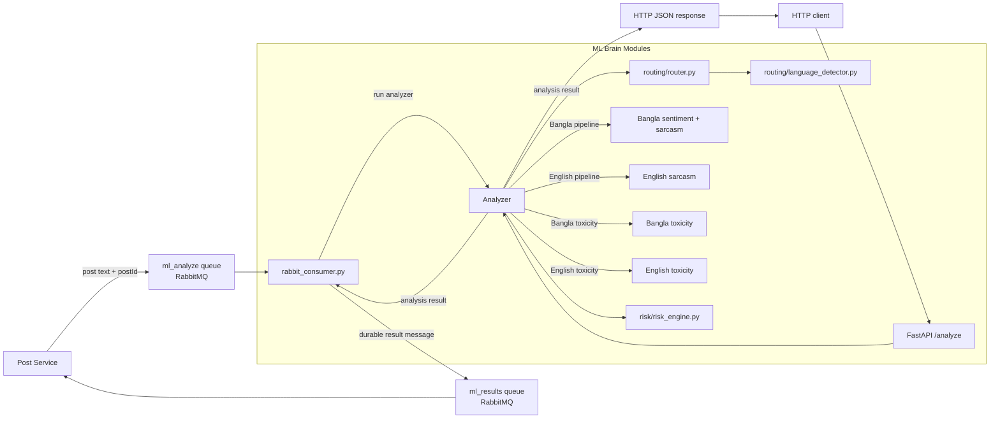

# VerbaScope ML Brain

The ML Brain is VerbaScope's Python inference service. It exposes direct text analysis over FastAPI and consumes asynchronous post-analysis jobs from RabbitMQ. One shared `Analyzer` coordinates language heuristics, language-specific model wrappers, toxicity scoring, and a threshold-based Green/Yellow/Red risk decision.

## What this service does

- Loads its four active model wrappers once when `main.py` is imported: Bangla sentiment/sarcasm, English sarcasm, Bangla toxicity, and English toxicity.
- Accepts direct requests through `POST /analyze` and queue jobs through RabbitMQ; both entry points call the same `Analyzer.analyze()` path.
- Publishes completed queue results to `ml_results` for post-service to consume.
- Provides `GET /health`, which reports that the API and models are up and also exposes the RabbitMQ consumer's thread and connection state.

## Responsibilities

- Detect the language of incoming text and route it to the correct model pipeline.
- Run Bangla sentiment/sarcasm and English sarcasm inference; the English sentiment wrapper is not currently wired into the active pipeline.
- Score toxicity and assign a moderation risk signal.
- Publish ML results back to the post service through RabbitMQ.
- Expose a lightweight health check and direct analysis endpoint for local debugging and integration tests.

## Architecture Diagram



The router selects a `bangla` or `english` pipeline; `pipelines/analyzer.py` maps that decision to the model instances. The separate `models/english_sentiment.py` wrapper exists in the repository but is not currently wired into the production Analyzer.

## Directory And File Guide

```text
ml-brain/
├── main.py
├── model_architecture.py
├── inspect_model.py
├── rabbit_consumer.py
├── requirements.txt
├── README.md
├── models/
│   ├── english_sarcasm.py
│   ├── english_sentiment.py
│   ├── english_toxicity.py
│   ├── sentiment_sarcasm.py
│   ├── toxicity.py
├── routing/
│   ├── language_detector.py
│   └── router.py
├── pipelines/
│   └── analyzer.py
├── risk/
│   └── risk_engine.py
├── evaluation/
│   ├── evaluate.py
│   ├── english_evaluation_dataset.csv
│   ├── evaluation_dataset.csv
│   ├── evaluation_metrics.py
│   ├── results.csv
├── tests/
│   ├── test_english_sarcasm.py
│   ├── test_english_sentiment.py
│   ├── test_long_bangla.py
│   ├── test_model.py
│   ├── test_pipeline.py
│   ├── test_risk_engine.py
│   ├── test_sentiment.py
│   ├── test_sentiment_sarcasm.py
│   └── test_toxicity.py
├── test.py
├── .env                  # Local configuration; do not commit secrets
├── .venv/                # Local virtual environment; generated
├── __pycache__/          # Python bytecode cache; generated
└── ...
```

### Root files and folders

| Path | Purpose |
| --- | --- |
| `main.py` | Creates the FastAPI app, loads the text-analysis models, starts the RabbitMQ consumer in a background thread, and defines `/health` and `/analyze`. |
| `model_architecture.py` | Defines the BanglaBERT encoder with shared dense features and separate sentiment and sarcasm classification heads. |
| `rabbit_consumer.py` | Declares durable `ml_analyze` and `ml_results` queues, consumes one job at a time, calls the shared Analyzer, publishes confirmed results, retries a failed job once, reconnects automatically with back-off, and exposes consumer status for `/health`. Logs never contain the broker URL or post text. |
| `inspect_model.py` | Utility script for debugging model structure and outputs during development. |
| `test.py` | Legacy stand-alone Transformers pipeline example; it does not invoke the production Analyzer. |
| `requirements.txt` | Declares FastAPI/Uvicorn, Transformers/PyTorch, Pika, dotenv, and evaluation/data packages. |
| `README.md` | This file. |

### `models/`

| Path | Purpose |
| --- | --- |
| `models/sentiment_sarcasm.py` | Bangla dual-head model wrapper; returns one of four calibrated sentiment classes and a sarcasm decision/probability. |
| `models/english_sentiment.py` | English sentiment wrapper present in the codebase, but currently not used by `Analyzer`. |
| `models/english_sarcasm.py` | CardiffNLP Twitter RoBERTa irony classifier, with preprocessing and a heuristic to suppress some obvious-positive false positives. |
| `models/toxicity.py` | Bengali toxicity regression wrapper; converts the model's 0–4 output to a clamped 1–5 score. |
| `models/english_toxicity.py` | English multi-label toxic-BERT wrapper; converts the strongest label probability to a discrete 1–5 score and provides label details. |

### `pipelines/`

| Path | Purpose |
| --- | --- |
| `pipelines/analyzer.py` | Shared orchestration for routing, model calls, risk scoring, explanations, and the final response shape used by both HTTP and RabbitMQ. |

### `routing/`

| Path | Purpose |
| --- | --- |
| `routing/language_detector.py` | Dependency-free Bangla/Latin script-count and Banglish-word-list heuristic. Returns `Bangla`, `English`, `Banglish`, `Mixed`, or `Unknown` plus heuristic confidence and character counts. |
| `routing/router.py` | Converts language detection into a `bangla` or `english` pipeline decision and a low-confidence flag/note. |

### `risk/`

| Path | Purpose |
| --- | --- |
| `risk/risk_engine.py` | Applies toxicity thresholds first, then sentiment/sarcasm conditions, to return `green`, `yellow`, or `red` with a toxicity level and explanation. |

### `evaluation/`

| Path | Purpose |
| --- | --- |
| `evaluation/evaluate.py` | Intended to run models against the labeled datasets and write `results.csv`; currently imports and reads router fields that do not exist in the current router API, and its fallback-language behavior also differs from the production Analyzer. |
| `evaluation/evaluation_metrics.py` | Reads `results.csv`, prints Green/Yellow/Red precision/recall/F1, and writes `confusion_matrix.png`. |
| `evaluation/evaluation_dataset.csv` | Main labeled dataset (146 data rows in the checked-in CSV); the evaluator's current skip rules leave 142 candidate rows. |
| `evaluation/english_evaluation_dataset.csv` | English dataset (50 data rows in this checkout), included by the evaluator when present. |
| `evaluation/results.csv` | Checked-in 192-row prediction snapshot; it is not verified as output from the current production pipeline. |
| `evaluation/confusion_matrix.png` | Output generated by `evaluation_metrics.py` after a successful metrics run; it is not present in the current checkout. |

The `tests/` directory contains stand-alone scripts rather than a consistently discoverable pytest suite. Some scripts still import pre-refactor module names, so verify and update them before treating them as current automated tests.

## Requirements And Setup

- Python 3.10 or newer is needed for syntax used in the source (including `str | None`).
- The model wrappers download weights/tokenizers from Hugging Face on the first run unless the assets are already cached.
- A reachable RabbitMQ broker is required for queue-driven jobs; the HTTP endpoint does not depend on RabbitMQ once model loading succeeds.
- Create and activate a virtual environment before installing the packages.

Install dependencies:

```bash
python -m pip install -r requirements.txt
```

## Environment Variables

`main.py` and `rabbit_consumer.py` load `.env` via `python-dotenv`. The active code reads the following environment variables:

| Variable | Required | Description |
| --- | --- | --- |
| `RABBITMQ_URL` | For queue jobs | Pika connection URL for the RabbitMQ/LavinMQ broker. It is read when the consumer starts, so it can also be set by the host environment or Colab Secrets. It contains credentials: never print or commit it. |
| `ML_API_KEY` | Recommended when exposed publicly | When set, `POST /analyze` requires a matching `X-API-Key` header. When unset, `/analyze` is open and a warning is printed at startup. |

There is no active `MODEL_PATH` override; model identifiers are defined in the wrappers. The HTTP port is set by the Uvicorn command, not read from `PORT`.

## Running The Service

From the `services/ml-brain` directory, start the HTTP service with Uvicorn:

```powershell
.\.venv\Scripts\Activate.ps1
uvicorn main:app --host 0.0.0.0 --port 8000
```

Importing `main.py` constructs the four active model wrappers before the HTTP server accepts requests. It then creates one shared `Analyzer` and starts `start_consumer(analyzer)` in a daemon thread. Model files and tokenizers are reused for subsequent requests in that process; each additional worker process loads its own copies. `python main.py` alone does not launch an HTTP server.

### Health check

```bash
curl http://localhost:8000/health
```

Typical response:

```json
{
  "status": "ok",
  "service": "verbascope-ml-brain",
  "model_loaded": true,
  "queue_consumer": {
    "connected": true,
    "reconnect_count": 0,
    "last_error_type": null,
    "last_message_at": null,
    "thread_alive": true
  }
}
```

`status` means the HTTP API is running. `model_loaded` is a constant `true` once startup finishes. The `queue_consumer` block shows the real queue state: `connected` is `false` while the consumer is reconnecting, `thread_alive` is `false` if the consumer thread has stopped (for example because `RABBITMQ_URL` is missing), and `last_error_type` holds only an exception class name. It never contains URLs or credentials.

### Text analysis endpoint

```bash
curl -X POST "http://localhost:8000/analyze" \
  -H "Content-Type: application/json" \
  -d '{"text": "This is a very toxic and sarcastic message."}'
```

If `ML_API_KEY` is set, add `-H "X-API-Key: <your key>"` to the request; a missing or wrong key returns `401`. Text longer than 10,000 characters is rejected with `422`. The endpoint accepts `{"text": "..."}` and returns the original text, detected language and heuristic confidence, selected routing pipeline, low-confidence routing information, sentiment, sarcasm, toxicity details, risk flag, toxicity level, explanation, and a selected model-confidence value. FastAPI's interactive API docs are available at `/docs`.

## RabbitMQ Integration

The consumer declares durable `ml_analyze` and `ml_results` queues, enables publisher confirms, and sets `prefetch_count=1`. For each JSON message, it reads `postId` and `text`, calls the same shared Analyzer as `/analyze`, publishes a persistent `ml.analysis.completed` message to `ml_results`, and acknowledges the input only after the broker has accepted the result.

- **Bad input:** a message that is not valid JSON, has no `postId`, or has empty text is acknowledged and skipped.
- **Processing errors:** a failed job is negatively acknowledged with `requeue=True` the first time, so it is retried once. If the broker marks the second delivery as redelivered and it fails again, it is dropped (`requeue=False`) so one bad message cannot loop forever. A dropped post keeps `ml = null` and can be repaired with the `reanalyzeStalePosts` backfill in post-service.
- **Reconnection:** `start_consumer` runs a loop. If the connection cannot be opened or is lost, it logs the exception class, waits 2s, 4s, 8s, ... up to 60s, and reconnects. The wait resets after a connection has stayed up for 60 seconds. The connection uses a 600-second heartbeat so a long CPU inference does not cause the broker to close it. If `RABBITMQ_URL` is missing, the consumer thread stops with a clear error and `/health` shows `thread_alive: false`.
- **Delivery guarantee:** delivery is at-least-once. After a reconnect, a message can be processed twice, so post-service should treat a repeated `ml.analysis.completed` result for the same `postId` as an overwrite.
- **Logging:** logs contain post IDs, text length, language and risk flag, never the broker URL or the post text.
- **Connection name:** the connection appears as `verbascope-ml-brain` in the broker's management UI.

## Language Routing

- `language_detector.py` counts Bangla-script and Latin letters and checks Latin tokens against a small Banglish word list. Its confidence is heuristic, not a calibrated probability.
- `router.py` maps Bangla to the Bangla pipeline and English to the English pipeline. Banglish uses the English pipeline as a low-confidence fallback. Mixed text uses the pipeline for the dominant script; ties default to Bangla. Unknown text defaults to Bangla and is marked low confidence.
- `Analyzer` calls the models for the selected pipeline; it does not skip sentiment/sarcasm for Banglish, mixed, or unknown input. English pipeline sentiment is currently set to the constant `Neutral`.

## Model Pipeline

### Multilingual language detection and routing

`route()` detects language, while `Analyzer` uses the selected pipeline name to choose models. The Bangla path is also the fallback for script-count ties and unknown text. Mixed and Banglish classification flags lower routing confidence but do not bypass inference.

### Sentiment and sarcasm (Bengali)

The Bengali wrapper uses the `ahs95/sentiment-sarcasm-detection-BanglaBERT` fine-tuned weights, a `csebuetnlp/banglabert_small` encoder, and calibrated sentiment/sarcasm thresholds. It returns Positive, Neutral, Negative, or Mixed sentiment plus a sarcasm label and probability.

### Sentiment and sarcasm (English)

The active English pipeline uses `cardiffnlp/twitter-roberta-base-irony` for sarcasm and `unitary/toxic-bert` for toxicity. `Analyzer` currently assigns `sentiment="Neutral"` for every English input; `models/english_sentiment.py` (CardiffNLP sentiment-latest) is present but is not loaded or called by the production pipeline.

### Toxicity

The Bangla toxicity wrapper uses `Polygl0t/bengali-banglabert-toxicity-classifier`, converts its regression output to a clamped 1–5 score, and returns that scalar. The English toxicity wrapper uses independent sigmoid probabilities for toxic-BERT's labels, selects the largest label probability, and maps it to a discrete 1–5 score. These scores are used by the risk engine.

### Risk rules

`risk/risk_engine.py` does not calculate a weighted formula. Toxicity has priority: score ≥3.5 is High/Red; score ≥2.0 and <3.5 is Medium/Yellow. Below 2.0, Unknown sentiment, detected sarcasm, or Negative/Mixed sentiment yields Yellow; otherwise the result is Green. Its explanation describes the branch. For English High/Medium toxicity, the Analyzer may append the top toxicity label and its probability.

## Evaluation Pipeline

The `evaluation/` folder contains labeled Bangla and English datasets, a prediction script, a metrics script, and a checked-in prediction snapshot. The Bangla CSV has 146 data rows; 142 satisfy the evaluator's current skip checks. The English CSV has 50 data rows, all of which satisfy those same filters. These are candidate rows only: the current evaluator cannot produce valid metrics against the production pipeline until its API and routing behavior are brought into sync.

- `evaluate.py` imports `ENGLISH_TOXICITY_MODEL`, which is not defined in `routing/router.py`, and accesses `RouteDecision.toxicity_model`, while the current decision exposes a `pipeline` field instead. It therefore fails before completing an evaluation.
- There is a second compatibility gap: `evaluate.py` handles Banglish, Mixed, and Unknown language results differently from `Analyzer`; the production Analyzer still executes the selected Bangla or English pipeline for those routes. Fixing only the obsolete import/field would not make its results representative of production.
- After the evaluator is made consistent with `Analyzer`, it is intended to write predictions to `results.csv`. `evaluation_metrics.py` expects `Expected AI Signal` and `Predicted AI Signal`, prints per-class metrics, and writes `confusion_matrix.png`.
- Do not cite the checked-in `results.csv` as a fresh benchmark or claim a particular Yellow-recall percentage from this checkout. The evaluator is currently incompatible, so no current-pipeline metric (including an 88.6% Yellow recall) is verified here.

After the evaluator and production routing are brought into sync, run the evaluation from the `services/ml-brain` directory:

```bash
python evaluation/evaluate.py
python evaluation/evaluation_metrics.py
```

## Running The Checks

The files under `tests/` are stand-alone scripts that load real model assets; this directory is not a conventional pytest suite. Several scripts still refer to old module paths/functions, so they should be reviewed against the current `models/`, `pipelines/`, and `risk/` APIs before use. The project does not currently document a verified one-command test suite.

## Dependencies

| Package | Purpose |
| --- | --- |
| `fastapi` | HTTP interface for local analysis and health checks |
| `transformers` | Tokenizers and model wrappers |
| `torch` | Deep-learning inference |
| `pika` | RabbitMQ messaging support |
| `python-dotenv` | Local environment loading |
| `pandas`, `scikit-learn`, `matplotlib` | Evaluation reports and confusion matrix |
| `pymongo` | Declared dependency; the active inference and queue code shown here does not write to MongoDB. |

## Operational Notes

- The first run can be slow and requires network/cache access because the model wrappers download checkpoints and tokenizers from Hugging Face.
- Wrappers call `model.eval()` and use `torch.no_grad()`; tensors are loaded on CPU by default. The current code does not select a GPU device.
- Models are loaded at module import before serving begins, increasing startup time and per-process memory. Running multiple Uvicorn workers duplicates these in-memory models.
- The RabbitMQ consumer shares the Analyzer and model instances with HTTP requests in the same process.
- The service treats model inference as a prediction layer, not as absolute truth.
- `/analyze` can be exposed through a tunnel such as ngrok. Set `ML_API_KEY` and send it from the calling service only, never from browser code. `RABBITMQ_URL` and `ML_API_KEY` belong in environment variables or Colab Secrets, never in the repository or in notebook output.
- On a free Colab runtime the process stops when the runtime is disconnected. Use a CPU runtime (the models are CPU-only), connect shortly before use, and check `GET /health` for `queue_consumer.connected`. Posts created while the service was down can be repaired with the `reanalyzeStalePosts` backfill.
- The delivery path is designed for moderation support and downstream platform integration rather than standalone human review.

## External Models

### Bengali models

- Encoder: `csebuetnlp/banglabert_small`; fine-tuned checkpoint and calibrated thresholds: `ahs95/sentiment-sarcasm-detection-BanglaBERT`.
- Toxicity: `Polygl0t/bengali-banglabert-toxicity-classifier`.

### English models

- Sarcasm: `cardiffnlp/twitter-roberta-base-irony`.
- Toxicity: `unitary/toxic-bert`.
- Sentiment wrapper available but not currently active in `Analyzer`: `cardiffnlp/twitter-roberta-base-sentiment-latest`.

## Interview Questions

### 1. FastAPI Bootstrapping And Model Memory: “How does `main.py` handle startup and model loading?”

`main.py` constructs the FastAPI app and then instantiates four model wrappers at module import: Bangla sentiment/sarcasm, English sarcasm, Bangla toxicity, and English toxicity. The wrappers load tokenizers and weights, call `eval()`, and inference uses `torch.no_grad()`. The resulting model objects are held by one `Analyzer` instance, which is shared by `POST /analyze` and the RabbitMQ consumer thread. This avoids loading weights per request, but startup waits for downloads/loading and every additional worker process has its own copies. This is import-time initialization, not a FastAPI startup/lifespan hook. `GET /health` returns a constant `model_loaded: true`; it does not report broker health.

### 2. Language Detection And Model Routing: “How does the ML Brain choose which models to run?”

`routing/language_detector.py` uses Unicode Bangla/Latin character counts and a small Banglish word list to classify text as Bangla, English, Banglish, Mixed, or Unknown. Its confidence is a routing heuristic. `routing/router.py` maps Bangla to the Bangla pipeline and English to the English pipeline; Banglish falls back to English at low confidence, Mixed chooses the dominant script (ties go to Bangla), and Unknown falls back to Bangla at low confidence. `pipelines/analyzer.py` then selects the corresponding model calls. These fallback cases still run a pipeline; the code does not skip sentiment/sarcasm inference for them.

### 3. Risk Engine: “How are Green, Yellow, and Red signals derived?”

`risk/risk_engine.py` uses rule thresholds rather than the proposed weighted formula. Toxicity ≥3.5 on the 1–5 scale immediately produces Red/High; ≥2.0 and <3.5 produces Yellow/Medium. With lower toxicity, Unknown sentiment, sarcasm, or Negative/Mixed sentiment produces Yellow; otherwise it produces Green. The rule returns a human-readable explanation. Toxic-BERT's top label may be appended to the explanation for English Medium/High toxicity. The proposed 3.0 override and 0.60/0.25/0.15 weighting are not implemented.

### 4. ML Evaluation & Benchmarking Suite (`services/ml-brain/evaluation/`): “How did you validate your ML models before deployment?”

Files involved are `evaluation/evaluate.py`, `evaluation/evaluation_metrics.py`, and `evaluation/evaluation_dataset.csv`, with `evaluation/english_evaluation_dataset.csv` providing an additional English set. The Bangla CSV contains 146 rows, of which 142 pass the evaluator's current skip checks; the English CSV contains 50 additional rows. The datasets provide expected sentiment, sarcasm, toxicity, and AI-signal labels. `evaluate.py` is intended to run the models and write predictions to `results.csv`, while `evaluation_metrics.py` reports Green/Yellow/Red precision, recall, and F1 and can generate a confusion matrix. However, the evaluator currently imports a router constant and reads a route field that do not exist, and its fallback-language handling does not match the production Analyzer. The checked-in `results.csv` is therefore only a snapshot, not verified evidence of current production performance. We cannot substantiate the suggested 119-post count or 88.6% Yellow-recall figure from this checkout; those should only be quoted after the evaluator is corrected, run successfully, and its results reviewed.

### 5. Ethical AI Design & Comparison vs. Facebook/Traditional Moderation: “Why use VerbaScope, and what is its core ethical design principle?”

VerbaScope's design goal is to support reflection and user agency rather than make an automated risk score a final verdict. The ML Brain returns a Green, Yellow, or Red signal with a human-readable explanation for the caller to present as an AI Signal Card. This service does not delete posts, shadowban users, or impose account penalties. The intended pre-post awareness experience can invite someone to pause and review their wording, while leaving the decision to the user and any applicable human moderation process. Describe the comparison as VerbaScope's design choice rather than making blanket claims about how Facebook or every other platform moderates content. The model can be wrong, so its signal should be presented as guidance, not ground truth.

### 6. RabbitMQ Consumer: “How are jobs acknowledged, and what happens if RabbitMQ disconnects?”

`main.py` starts `start_consumer(analyzer)` in a daemon thread. The consumer declares durable `ml_analyze` and `ml_results` queues, enables publisher confirms, limits unacknowledged work to one message, reads `postId` and `text`, and runs the shared Analyzer. It publishes a persistent `ml.analysis.completed` result and acknowledges the input only after the broker confirms the publish, so a failed publish cannot silently lose an analysis. Invalid JSON or empty text is acknowledged and skipped. A processing error is requeued once and then dropped, so a poison message cannot loop forever; the affected post keeps `ml = null` and the backfill job can re-run it. If the connection drops, `start_consumer` reconnects automatically with exponential back-off (2s up to 60s) and a 600-second heartbeat protects long inferences. `GET /health` reports whether the consumer is connected, how many reconnects have happened, and the last error class. Delivery is at-least-once, so a result may occasionally be published twice after a reconnect. The honest limitation is that a free Colab runtime can still be stopped by Google when idle, and no reconnect loop can help when the whole process is gone.

## Project Status

The service supports direct HTTP inference and asynchronous RabbitMQ inference. The active pipeline currently uses rule-based language routing and risk thresholds; English sentiment remains a `Neutral` placeholder, the evaluator and some stand-alone test scripts still reference older APIs, and RabbitMQ disconnections are retried automatically with back-off.

## TO RUN THE SERVER

From the ML Brain directory:

```powershell
.\.venv\Scripts\Activate.ps1
uvicorn main:app --host 0.0.0.0 --port 8000
```

## If you really want auto-reload during development

Uvicorn can reload the app when source files change:

```powershell
uvicorn main:app --reload --port 8000
```

Reloading re-imports `main.py` and reloads all model weights, so it can take time and use substantial memory. The project does not currently provide a verified test command; see [Running The Checks](#running-the-checks) before relying on the scripts in `tests/`.