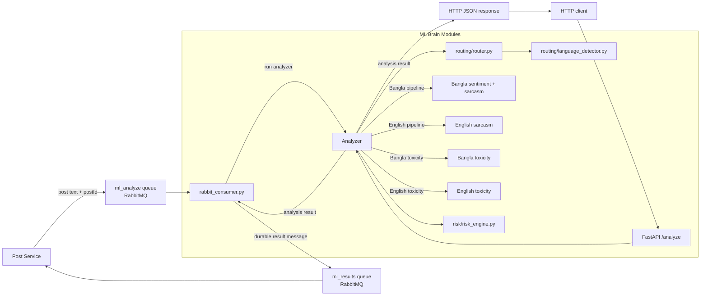

# VerbaScope ML Brain

The ML Brain is VerbaScope's Python inference service. It exposes direct text analysis over FastAPI and consumes asynchronous post-analysis jobs from RabbitMQ. One shared `Analyzer` coordinates language heuristics, language-specific model wrappers, toxicity scoring, and a threshold-based Green/Yellow/Red risk decision.

## What this service does

- Loads its five active model wrappers once when `main.py` is imported: Bangla sentiment/sarcasm, English sarcasm, English sentiment, Bangla toxicity, and English toxicity.
- Accepts direct requests through `POST /analyze` and queue jobs through RabbitMQ; both entry points call the same `Analyzer.analyze()` path.
- Publishes completed queue results to `ml_results` for post-service to consume.
- Provides `GET /health`, which reports that the API and models are up and also exposes the RabbitMQ consumer's thread and connection state.

## Responsibilities

- Detect the language of incoming text and route it to the correct model pipeline.
- Run Bangla sentiment/sarcasm and English sarcasm and sentiment inference.
- Score toxicity and assign a moderation risk signal.
- Publish ML results back to the post service through RabbitMQ.
- Expose a lightweight health check and direct analysis endpoint for local debugging and integration tests.

## Architecture Diagram



The router selects a `bangla` or `english` pipeline; `pipelines/analyzer.py` maps that decision to the model instances. `models/english_sentiment.py` provides English sentiment and is loaded by `main.py` and passed to the Analyzer. Posts that contain both Bangla script and English words take a separate code-mixed path (see [Code-mixed pipeline](#code-mixed-pipeline)).

## Directory And File Guide

```text
ml-brain/
├── main.py
├── model_architecture.py
├── rabbit_consumer.py
├── evaluate_api.py            # current evaluator (calls POST /analyze)
├── requirements.txt
├── README.md
├── models/
│   ├── english_sarcasm.py
│   ├── english_sentiment.py
│   ├── english_toxicity.py
│   ├── sentiment_sarcasm.py
│   └── toxicity.py
├── routing/
│   ├── language_detector.py
│   ├── router.py
│   └── segmenter.py
├── pipelines/
│   ├── analyzer.py
│   ├── lexicon.py
│   ├── mixed_runner.py
│   └── mixed_aggregate.py
├── risk/
│   └── risk_engine.py
├── evaluation/
│   ├── evaluation_dataset.csv
│   ├── evaluation_dataset_clean.csv
│   ├── english_evaluation_dataset.csv
│   ├── evaluation_code_mixed_test_dataset_extended_fixed.csv
│   ├── dev_errors.csv         # posts the system got wrong during development
│   └── results.csv            # legacy snapshot; do not cite
├── results/                   # generated by evaluate_api.py; see RUNS.md
├── tests/                     # stand-alone model test scripts (not a pytest suite)
├── tools/                     # diagnostics: diff_runs, scope_report, inspect_model,
│                              # measure_memory, try_analyze_mixed
├── archive/                   # old or broken scripts kept for reference
├── .env                  # Local configuration; do not commit secrets
├── .venv/                # Local virtual environment; generated
├── __pycache__/          # Python bytecode cache; generated
└── ...
```

### Root files and folders

| Path | Purpose |
| --- | --- |
| `main.py` | Creates the FastAPI app, loads the text-analysis models, starts the RabbitMQ consumer in a background thread, and defines `/health` and `/analyze`. |
| `model_architecture.py` | Defines the BanglaBERT encoder with shared dense features and separate sentiment and sarcasm classification heads. |
| `rabbit_consumer.py` | Declares durable `ml_analyze` and `ml_results` queues, consumes one job at a time, calls the shared Analyzer, publishes confirmed results, retries a failed job once, reconnects automatically with back-off, and exposes consumer status for `/health`. Logs never contain the broker URL or post text. |
| `evaluate_api.py` | Current evaluator. Sends each labeled post to a running service's `POST /analyze` and writes metrics and per-row results to `results/`. See [Evaluation Pipeline](#evaluation-pipeline). |
| `tools/inspect_model.py` | Utility script for debugging model structure and outputs during development. |
| `archive/test.py` | Legacy stand-alone Transformers pipeline example; it does not invoke the production Analyzer. |
| `requirements.txt` | Declares FastAPI/Uvicorn, Transformers/PyTorch, Pika, dotenv, and evaluation/data packages. |
| `README.md` | This file. |

### `models/`

| Path | Purpose |
| --- | --- |
| `models/sentiment_sarcasm.py` | Bangla dual-head model wrapper; returns one of four calibrated sentiment classes and a sarcasm decision/probability. |
| `models/english_sentiment.py` | CardiffNLP twitter-roberta-base-sentiment-latest wrapper; returns Positive/Neutral/Negative with a confidence. Used by the English pipeline and the code-mixed pipeline. |
| `models/english_sarcasm.py` | CardiffNLP Twitter RoBERTa irony classifier, with preprocessing and a heuristic to suppress some obvious-positive false positives. |
| `models/toxicity.py` | Bengali toxicity regression wrapper; converts the model's 0–4 output to a clamped 1–5 score. |
| `models/english_toxicity.py` | English multi-label toxic-BERT wrapper; converts the strongest label probability to a discrete 1–5 score and provides label details. |

### `pipelines/`

| Path | Purpose |
| --- | --- |
| `pipelines/analyzer.py` | Shared orchestration for routing, model calls, risk scoring, explanations, and the final response shape used by both HTTP and RabbitMQ. Holds the `USE_MIXED_PIPELINE` switch. |
| `pipelines/mixed_runner.py` | Code-mixed path: runs the right models on each sentence (Bangla models read the whole sentence, English models read only the English words). |
| `pipelines/mixed_aggregate.py` | Code-mixed path: merges the per-sentence results into one post-level analysis. |
| `pipelines/lexicon.py` | Small rule-based word list for threats, abuse and self-harm phrases (Bangla script and English only). It can only raise toxicity, and runs only on code-mixed posts. |

### `routing/`

| Path | Purpose |
| --- | --- |
| `routing/language_detector.py` | Dependency-free Bangla/Latin script-count heuristic. Returns `Bangla`, `English`, `Mixed`, or `Unknown` plus heuristic confidence and character counts. Romanized Bangla is out of scope and is detected as English. |
| `routing/router.py` | Converts language detection into a `bangla` or `english` pipeline decision and a low-confidence flag/note. |
| `routing/segmenter.py` | Splits text into sentences and records, for each, whether it has Bangla script and which English words it contains. |

### `risk/`

| Path | Purpose |
| --- | --- |
| `risk/risk_engine.py` | Applies toxicity thresholds first, then sentiment/sarcasm conditions, to return `green`, `yellow`, or `red` with a toxicity level and explanation. |

### `evaluation/`

| Path | Purpose |
| --- | --- |
| `evaluation/evaluation_dataset.csv` | Main Bangla labeled dataset: 146 data rows; 4 rows marked `Exclude=yes` are skipped, leaving 142 evaluated. Labels follow `LABEL_DEFINITIONS.md` (repo root). |
| `evaluation/english_evaluation_dataset.csv` | English labeled dataset: 50 data rows, all evaluated. |
| `evaluation/evaluation_dataset_clean.csv` | Copy of the Bangla set with five annotator notes removed from the `Text` column (for example `[trimmed]`). Only `Text` differs in those 5 cells; no label changed. Use this one for code-mixed comparisons. |
| `evaluation/evaluation_code_mixed_test_dataset_extended_fixed.csv` | 50 synthetic code-mixed posts (42 with Bangla script plus English words, 8 pure Bangla), written for development tests. Cleaner than real posts, so use it to compare settings, not to report real-world accuracy. |
| `evaluation/dev_errors.csv` | 7 posts the system got wrong during development. Kept outside the test sets. |
| `archive/evaluation_metrics.py` | Legacy metrics script. Reads the legacy `results.csv`, prints Green/Yellow/Red precision/recall/F1, and writes `confusion_matrix.png`. Not part of the current evaluation flow. |
| `archive/evaluate.py` | Legacy evaluator. It imports a router constant and reads a field that no longer exist, so it fails. Do not use; use `evaluate_api.py`. |
| `evaluation/results.csv` | Legacy 192-row snapshot from the old evaluator. Not verified against the current pipeline; do not cite it. |

### `results/`

Generated by `evaluate_api.py` on each run: `*_report.txt`, `*_results.csv`, `*_errors.csv`, `*_raw.jsonl` (and `*_raw_run2.jsonl` when `--check-determinism` is used). `results/RUNS.md` lists which code setting produced each run.

The `tests/` directory contains stand-alone scripts rather than a consistently discoverable pytest suite. Some scripts still import pre-refactor module names, so verify and update them before treating them as current automated tests.

## Requirements And Setup

- Python 3.10 or newer is needed for syntax used in the source (including `str | None`).
- The model wrappers download weights/tokenizers from Hugging Face on the first run unless the assets are already cached.
- A reachable RabbitMQ broker is required for queue-driven jobs; the HTTP endpoint does not depend on RabbitMQ once model loading succeeds.
- Create and activate a virtual environment before installing the packages.

Install dependencies:

```bash
python -m pip install -r requirements.txt
```

## Environment Variables

`main.py` and `rabbit_consumer.py` load `.env` via `python-dotenv`. The active code reads the following environment variables:

| Variable | Required | Description |
| --- | --- | --- |
| `RABBITMQ_URL` | For queue jobs | Pika connection URL for the RabbitMQ/LavinMQ broker. It is read when the consumer starts, so it can also be set by the host environment or Colab Secrets. It contains credentials: never print or commit it. |
| `ML_API_KEY` | Recommended when exposed publicly | When set, `POST /analyze` requires a matching `X-API-Key` header. When unset, `/analyze` is open and a warning is printed at startup. |

There is no active `MODEL_PATH` override; model identifiers are defined in the wrappers. The HTTP port is set by the Uvicorn command, not read from `PORT`.

## Running The Service

From the `services/ml-brain` directory, start the HTTP service with Uvicorn:

```powershell
.\.venv\Scripts\Activate.ps1
uvicorn main:app --host 0.0.0.0 --port 8000
```

Importing `main.py` constructs the four active model wrappers before the HTTP server accepts requests. It then creates one shared `Analyzer` and starts `start_consumer(analyzer)` in a daemon thread. Model files and tokenizers are reused for subsequent requests in that process; each additional worker process loads its own copies. `python main.py` alone does not launch an HTTP server.

### Health check

```bash
curl http://localhost:8000/health
```

Typical response:

```json
{
  "status": "ok",
  "service": "verbascope-ml-brain",
  "model_loaded": true,
  "queue_consumer": {
    "connected": true,
    "reconnect_count": 0,
    "last_error_type": null,
    "last_message_at": null,
    "thread_alive": true
  }
}
```

`status` means the HTTP API is running. `model_loaded` is a constant `true` once startup finishes. The `queue_consumer` block shows the real queue state: `connected` is `false` while the consumer is reconnecting, `thread_alive` is `false` if the consumer thread has stopped (for example because `RABBITMQ_URL` is missing), and `last_error_type` holds only an exception class name. It never contains URLs or credentials.

### Text analysis endpoint

```bash
curl -X POST "http://localhost:8000/analyze" \
  -H "Content-Type: application/json" \
  -d '{"text": "This is a very toxic and sarcastic message."}'
```

If `ML_API_KEY` is set, add `-H "X-API-Key: <your key>"` to the request; a missing or wrong key returns `401`. Text longer than 10,000 characters is rejected with `422`. The endpoint accepts `{"text": "..."}` and returns the original text, detected language and heuristic confidence, selected routing pipeline, low-confidence routing information, sentiment, sarcasm, toxicity details, risk flag, toxicity level, explanation, and a selected model-confidence value. FastAPI's interactive API docs are available at `/docs`.

## RabbitMQ Integration

The consumer declares durable `ml_analyze` and `ml_results` queues, enables publisher confirms, and sets `prefetch_count=1`. For each JSON message, it reads `postId` and `text`, calls the same shared Analyzer as `/analyze`, publishes a persistent `ml.analysis.completed` message to `ml_results`, and acknowledges the input only after the broker has accepted the result.

- **Bad input:** a message that is not valid JSON, has no `postId`, or has empty text is acknowledged and skipped.
- **Processing errors:** a failed job is negatively acknowledged with `requeue=True` the first time, so it is retried once. If the broker marks the second delivery as redelivered and it fails again, it is dropped (`requeue=False`) so one bad message cannot loop forever. A dropped post keeps `ml = null` and can be repaired with the `reanalyzeStalePosts` backfill in post-service.
- **Reconnection:** `start_consumer` runs a loop. If the connection cannot be opened or is lost, it logs the exception class, waits 2s, 4s, 8s, ... up to 60s, and reconnects. The wait resets after a connection has stayed up for 60 seconds. The connection uses a 600-second heartbeat so a long CPU inference does not cause the broker to close it. If `RABBITMQ_URL` is missing, the consumer thread stops with a clear error and `/health` shows `thread_alive: false`.
- **Delivery guarantee:** delivery is at-least-once. After a reconnect, a message can be processed twice, so post-service should treat a repeated `ml.analysis.completed` result for the same `postId` as an overwrite.
- **Logging:** logs contain post IDs, text length, language and risk flag, never the broker URL or the post text.
- **Connection name:** the connection appears as `verbascope-ml-brain` in the broker's management UI.

## Language Routing

- `language_detector.py` counts Bangla-script and Latin letters and returns `Bangla`, `English`, `Mixed` or `Unknown`. Romanized Bangla ("Banglish") is out of scope: it is Latin script, so it is detected as English and results for it are not reliable. Its confidence is heuristic, not a calibrated probability.
- `router.py` maps Bangla to the Bangla pipeline and English to the English pipeline. Mixed text uses the pipeline for the dominant script; ties default to Bangla. Unknown text defaults to Bangla and is marked low confidence.
- `Analyzer` calls the models for the selected pipeline; it does not skip sentiment/sarcasm for mixed or unknown input. A post that has both Bangla script and English words is handled by the [code-mixed pipeline](#code-mixed-pipeline) unless `USE_MIXED_PIPELINE=0` is set.

## Model Pipeline

### Multilingual language detection and routing

`route()` detects language, while `Analyzer` uses the selected pipeline name to choose models. The Bangla path is also the fallback for script-count ties and unknown text. Mixed classification flags lower routing confidence but does not bypass inference.

### Sentiment and sarcasm (Bengali)

The Bengali wrapper uses the `ahs95/sentiment-sarcasm-detection-BanglaBERT` fine-tuned weights, a `csebuetnlp/banglabert_small` encoder, and calibrated sentiment/sarcasm thresholds. It returns Positive, Neutral, Negative, or Mixed sentiment plus a sarcasm label and probability.

### Sentiment and sarcasm (English)

The active English pipeline uses `cardiffnlp/twitter-roberta-base-irony` for sarcasm and `unitary/toxic-bert` for toxicity. English sentiment comes from `cardiffnlp/twitter-roberta-base-sentiment-latest` (`models/english_sentiment.py`), which `main.py` loads and passes to the `Analyzer`.

### Toxicity

The Bangla toxicity wrapper uses `Polygl0t/bengali-banglabert-toxicity-classifier`, converts its regression output to a clamped 1–5 score, and returns that scalar. The English toxicity wrapper uses independent sigmoid probabilities for toxic-BERT's labels, selects the largest label probability, and maps it to a discrete 1–5 score. These scores are used by the risk engine.

### Risk rules

`risk/risk_engine.py` does not calculate a weighted formula. Toxicity has priority: score ≥3.5 is High/Red; score ≥2.0 and <3.5 is Medium/Yellow. Below 2.0, Unknown sentiment, detected sarcasm, or Negative/Mixed sentiment yields Yellow; otherwise the result is Green. Its explanation describes the branch. For English High/Medium toxicity, the Analyzer may append the top toxicity label and its probability.

## Code-mixed pipeline

**Status: experimental. On real posts it did not improve accuracy (see results below). The old route is the safer default for accuracy; this pipeline is kept as an option.**

A post is treated as code-mixed when it contains Bangla-script letters and at least one English word. Instead of sending the whole post to one language's models, the code-mixed pipeline works sentence by sentence:

1. `routing/segmenter.py` splits the post into sentences and records the English words of each.
2. `pipelines/mixed_runner.py` runs the models. Bangla models read the whole sentence. English models (toxicity, sentiment, sarcasm) read only the English words of that sentence. When a sentence has both languages, it counts as sarcastic only if both sarcasm models agree.
3. `pipelines/mixed_aggregate.py` merges the sentences into one result: toxicity is the highest score from any sentence and either model; sentiment is Negative if any model says Negative, otherwise Mixed, otherwise Positive; sarcasm is true if any sentence is sarcastic.
4. `pipelines/lexicon.py` can raise (never lower) the toxicity score when it finds a threat, abuse or self-harm phrase.

**Switch.** The environment variable `USE_MIXED_PIPELINE` controls the split-and-merge step (default on). Set it to `0` to send code-mixed posts through the older route (whole post to the dominant-script pipeline). The word list stays active for code-mixed posts in both settings.

```powershell
$env:USE_MIXED_PIPELINE="0"; uvicorn main:app --host 127.0.0.1 --port 8000 --workers 1
```

**Scope.** Bangla script, English, and Bangla-English code-mixed text. Romanized Bangla (for example "ami tomake bhalobashi") is out of scope; results for it are not reliable.

## Evaluation Pipeline

Evaluation uses `evaluate_api.py`, which sends every labeled post to a running ml-brain instance through `POST /analyze`. This is the same code path production uses. The legacy `evaluation/evaluate.py` is broken (it imports a router constant and reads a field that no longer exist) and is not used.

Labels follow `LABEL_DEFINITIONS.md` (repo root). The datasets were revised against these definitions on 7 Nov 2026. Rows marked `Exclude=yes` are skipped. The Bangla set has 146 data rows (142 evaluated, 4 skipped); the English set has 50 data rows (all evaluated).

To reproduce (comment out `RABBITMQ_URL` in `.env` first so the evaluation cannot consume live queue messages, and restore it afterwards):

```powershell
uvicorn main:app --host 127.0.0.1 --port 8000 --workers 1
python evaluate_api.py --csv evaluation\evaluation_dataset.csv --check-determinism
python evaluate_api.py --csv evaluation\english_evaluation_dataset.csv
```

Wait until `GET /health` reports `model_loaded: true` before running the evaluation. Outputs go to `results/` (`*_report.txt`, `*_results.csv`, `*_errors.csv`, `*_raw.jsonl`).

### Baseline results (run on 7 Nov 2026, before any code-mixed pipeline work)

**Bangla** (142 evaluated, 4 skipped; Green 33 / Yellow 84 / Red 25)

| Class | Precision | Recall | F1 |
| --- | --- | --- | --- |
| Green | 0.607 | 0.515 | 0.557 |
| Yellow | 0.657 | 0.845 | 0.740 |
| Red | 0.500 | 0.120 | 0.194 |

Accuracy 0.641, macro-F1 0.497. Red↔Green confusions: 1. Predictions were identical across two runs.

| Expected \ Predicted | Green | Yellow | Red |
| --- | --- | --- | --- |
| Green | 17 | 16 | 0 |
| Yellow | 10 | 71 | 3 |
| Red | 1 | 21 | 3 |

**English** (50 evaluated; Green 10 / Yellow 20 / Red 20)

| Class | Precision | Recall | F1 |
| --- | --- | --- | --- |
| Green | 0.391 | 0.900 | 0.545 |
| Yellow | 0.600 | 0.300 | 0.400 |
| Red | 1.000 | 0.850 | 0.919 |

Accuracy 0.640, macro-F1 0.621. Red↔Green confusions: 0.

| Expected \ Predicted | Green | Yellow | Red |
| --- | --- | --- | --- |
| Green | 9 | 1 | 0 |
| Yellow | 14 | 6 | 0 |
| Red | 0 | 3 | 17 |

### English results after the English sentiment model was wired in (8 Nov 2026)

Same 50 English posts (Green 10 / Yellow 20 / Red 20). Three runs gave identical predictions.

| Class | Precision | Recall | F1 |
| --- | --- | --- | --- |
| Green | 0.692 | 0.900 | 0.783 |
| Yellow | 0.800 | 0.800 | 0.800 |
| Red | 1.000 | 0.850 | 0.919 |

Accuracy 0.840, macro-F1 0.834. Red↔Green confusions: 0.

| Expected \ Predicted | Green | Yellow | Red |
| --- | --- | --- | --- |
| Green | 9 | 1 | 0 |
| Yellow | 4 | 16 | 0 |
| Red | 0 | 3 | 17 |

### Code-mixed experiment (9-10 Nov 2026)

Both designs were run on the same data. "Split" is the code-mixed pipeline above; "old route" sends the whole post to the dominant-script pipeline. Run IDs are in `results/RUNS.md`.

| Dataset | Design | Accuracy | Macro-F1 | Red caught |
| --- | --- | --- | --- | --- |
| Bangla set, clean copy (142 real posts) | old route | **0.634** | **0.488** | 3 / 25 |
| Bangla set, clean copy (142 real posts) | split | 0.606 | 0.453 | 3 / 25 |
| Synthetic code-mixed set (50 posts) | old route | **0.600** | 0.515 | 2 / 12 |
| Synthetic code-mixed set (50 posts) | split | 0.580 | **0.563** | **6 / 12** |

- On the 142 real posts the difference is 4 posts, which is within the noise of a set this size (roughly ±0.08 at 95%). Only 19 of those posts are code-mixed (old route 14 right, split 10 right); the other 123 posts are unchanged.
- On the synthetic set the split design caught more threats (6 of 12 against 2 of 12) but also marked 3 Yellow posts as Red (harsh reviews), against 0 for the old route.
- Median response time on a laptop: about 0.3 s (old route) and about 0.5 s (split), one run each.
- Conclusion: the split design did not improve accuracy on real posts. It helped catch explicit threats on synthetic data at the cost of false alarms and speed. This is a negative result on small data, not a final verdict.

### Known limitations

- Bangla: most Red posts (21 of 25) are predicted Yellow, so Red recall is low. The system rarely labels a Red post Green (1 case).
- English: at the 7 Nov baseline, sentiment was a constant `Neutral`, so Negative posts without high toxicity fell to Green instead of Yellow. That explained the low Yellow recall; after the English sentiment model was wired in, the same set scores 0.840 (see below).
- The English set has only 50 posts, so its numbers are indicative only.
- Code-mixed: only 19 posts in the Bangla set are code-mixed, so no firm conclusion about code-mixed accuracy can be drawn. The 50-post synthetic code-mixed set was written for testing and is cleaner than real posts; some of its threat phrases also resemble the word list.
- Several clearly positive code-mixed posts are marked Yellow because the Bangla sentiment model returns Negative for them (suspected cause, not yet proven). It happened with the split design on and off.
- Romanized Bangla is out of scope; the system can return confident but wrong signals for it.
- Labels are human-annotated by the project team; there is no second annotator.
- These are baseline numbers. They are not tuned and should not be compared with earlier figures from the legacy evaluator or the old `results.csv`.

## Running The Checks

The files under `tests/` are stand-alone scripts that load real model assets; this directory is not a conventional pytest suite. Several scripts still refer to old module paths/functions, so they should be reviewed against the current `models/`, `pipelines/`, and `risk/` APIs before use. The project does not currently document a verified one-command test suite. Scripts with stale imports were moved to `archive/`; diagnostic scripts live in `tools/` and are run from this folder as `python -m tools.<name>`.

## Dependencies

| Package | Purpose |
| --- | --- |
| `fastapi` | HTTP interface for local analysis and health checks |
| `transformers` | Tokenizers and model wrappers |
| `torch` | Deep-learning inference |
| `pika` | RabbitMQ messaging support |
| `python-dotenv` | Local environment loading |
| `pandas`, `scikit-learn`, `matplotlib` | Evaluation reports and confusion matrix |
| `pymongo` | Declared dependency; the active inference and queue code shown here does not write to MongoDB. |

## Operational Notes

- The first run can be slow and requires network/cache access because the model wrappers download checkpoints and tokenizers from Hugging Face.
- Wrappers call `model.eval()` and use `torch.no_grad()`; tensors are loaded on CPU by default. The current code does not select a GPU device.
- Models are loaded at module import before serving begins, increasing startup time and per-process memory. Running multiple Uvicorn workers duplicates these in-memory models.
- The RabbitMQ consumer shares the Analyzer and model instances with HTTP requests in the same process.
- The service treats model inference as a prediction layer, not as absolute truth.
- `/analyze` can be exposed through a tunnel such as ngrok. Set `ML_API_KEY` and send it from the calling service only, never from browser code. `RABBITMQ_URL` and `ML_API_KEY` belong in environment variables or Colab Secrets, never in the repository or in notebook output.
- On a free Colab runtime the process stops when the runtime is disconnected. Use a CPU runtime (the models are CPU-only), connect shortly before use, and check `GET /health` for `queue_consumer.connected`. Posts created while the service was down can be repaired with the `reanalyzeStalePosts` backfill.
- The delivery path is designed for moderation support and downstream platform integration rather than standalone human review.

## External Models

### Bengali models

- Encoder: `csebuetnlp/banglabert_small`; fine-tuned checkpoint and calibrated thresholds: `ahs95/sentiment-sarcasm-detection-BanglaBERT`.
- Toxicity: `Polygl0t/bengali-banglabert-toxicity-classifier`.

### English models

- Sarcasm: `cardiffnlp/twitter-roberta-base-irony`.
- Toxicity: `unitary/toxic-bert`.
- Sentiment wrapper available but not currently active in `Analyzer`: `cardiffnlp/twitter-roberta-base-sentiment-latest`.

## Interview Questions

### 1. FastAPI Bootstrapping And Model Memory: “How does `main.py` handle startup and model loading?”

`main.py` constructs the FastAPI app and then instantiates five model wrappers at module import: Bangla sentiment/sarcasm, English sarcasm, English sentiment, Bangla toxicity, and English toxicity. The wrappers load tokenizers and weights, call `eval()`, and inference uses `torch.no_grad()`. The resulting model objects are held by one `Analyzer` instance, which is shared by `POST /analyze` and the RabbitMQ consumer thread. This avoids loading weights per request, but startup waits for downloads/loading and every additional worker process has its own copies. This is import-time initialization, not a FastAPI startup/lifespan hook. `GET /health` returns a constant `model_loaded: true`; it does not report broker health.

### 2. Language Detection And Model Routing: “How does the ML Brain choose which models to run?”

`routing/language_detector.py` uses Unicode Bangla/Latin character counts to classify text as Bangla, English, Mixed, or Unknown (romanized Bangla is out of scope and is detected as English). Its confidence is a routing heuristic. `routing/router.py` maps Bangla to the Bangla pipeline and English to the English pipeline; Mixed chooses the dominant script (ties go to Bangla), and Unknown falls back to Bangla at low confidence. `pipelines/analyzer.py` then selects the corresponding model calls. These fallback cases still run a pipeline; the code does not skip sentiment/sarcasm inference for them. Posts with both Bangla script and English words are handled by a separate code-mixed pipeline that can be switched off with `USE_MIXED_PIPELINE=0`.

### 3. Risk Engine: “How are Green, Yellow, and Red signals derived?”

`risk/risk_engine.py` uses rule thresholds rather than the proposed weighted formula. Toxicity ≥3.5 on the 1–5 scale immediately produces Red/High; ≥2.0 and <3.5 produces Yellow/Medium. With lower toxicity, Unknown sentiment, sarcasm, or Negative/Mixed sentiment produces Yellow; otherwise it produces Green. The rule returns a human-readable explanation. Toxic-BERT's top label may be appended to the explanation for English Medium/High toxicity. The proposed 3.0 override and 0.60/0.25/0.15 weighting are not implemented.

### 4. ML Evaluation & Benchmarking Suite (`services/ml-brain/`): “How did you validate your ML models before deployment?”

We evaluate through `evaluate_api.py`, which calls the running service's `POST /analyze`, so the test exercises the same path as production. The Bangla set has 146 labeled posts (142 evaluated after 4 exclusions) and the English set has 50. Labels follow written definitions in `LABEL_DEFINITIONS.md`. Baseline results: Bangla accuracy 0.641 and macro-F1 0.497, with strong Yellow recall (0.845) but weak Red recall (0.120); English accuracy 0.640 and macro-F1 0.621 at the 7 Nov baseline (weak Yellow recall, because English sentiment was then a `Neutral` placeholder), rising to 0.840 and 0.834 once the English sentiment model was wired in; Red performance stayed strong (precision 1.000, recall 0.850). Red↔Green confusions were 1 (Bangla) and 0 (English). Two runs gave identical predictions. These are honest baselines on small, human-annotated sets, and they are the "before" numbers for the code-mixed pipeline experiment, whose results are reported above (it did not improve accuracy on real posts).

### 5. Ethical AI Design & Comparison vs. Facebook/Traditional Moderation: “Why use VerbaScope, and what is its core ethical design principle?”

VerbaScope's design goal is to support reflection and user agency rather than make an automated risk score a final verdict. The ML Brain returns a Green, Yellow, or Red signal with a human-readable explanation for the caller to present as an AI Signal Card. This service does not delete posts, shadowban users, or impose account penalties. The intended pre-post awareness experience can invite someone to pause and review their wording, while leaving the decision to the user and any applicable human moderation process. Describe the comparison as VerbaScope's design choice rather than making blanket claims about how Facebook or every other platform moderates content. The model can be wrong, so its signal should be presented as guidance, not ground truth.

### 6. RabbitMQ Consumer: “How are jobs acknowledged, and what happens if RabbitMQ disconnects?”

`main.py` starts `start_consumer(analyzer)` in a daemon thread. The consumer declares durable `ml_analyze` and `ml_results` queues, enables publisher confirms, limits unacknowledged work to one message, reads `postId` and `text`, and runs the shared Analyzer. It publishes a persistent `ml.analysis.completed` result and acknowledges the input only after the broker confirms the publish, so a failed publish cannot silently lose an analysis. Invalid JSON or empty text is acknowledged and skipped. A processing error is requeued once and then dropped, so a poison message cannot loop forever; the affected post keeps `ml = null` and the backfill job can re-run it. If the connection drops, `start_consumer` reconnects automatically with exponential back-off (2s up to 60s) and a 600-second heartbeat protects long inferences. `GET /health` reports whether the consumer is connected, how many reconnects have happened, and the last error class. Delivery is at-least-once, so a result may occasionally be published twice after a reconnect. The honest limitation is that a free Colab runtime can still be stopped by Google when idle, and no reconnect loop can help when the whole process is gone.

## Project Status

The service supports direct HTTP inference and asynchronous RabbitMQ inference. The active pipeline uses rule-based language routing and risk thresholds; code-mixed posts go through an experimental split-and-merge pipeline that can be switched off with `USE_MIXED_PIPELINE=0`; the legacy evaluator is replaced by `evaluate_api.py` (baseline results above), some stand-alone test scripts still reference older APIs, and RabbitMQ disconnections are retried automatically with back-off.

## TO RUN THE SERVER

From the ML Brain directory:

```powershell
.\.venv\Scripts\Activate.ps1
uvicorn main:app --host 0.0.0.0 --port 8000
```

## If you really want auto-reload during development

Uvicorn can reload the app when source files change:

```powershell
uvicorn main:app --reload --port 8000
```

Reloading re-imports `main.py` and reloads all model weights, so it can take time and use substantial memory. The project does not currently provide a verified test command; see [Running The Checks](#running-the-checks) before relying on the scripts in `tests/`.