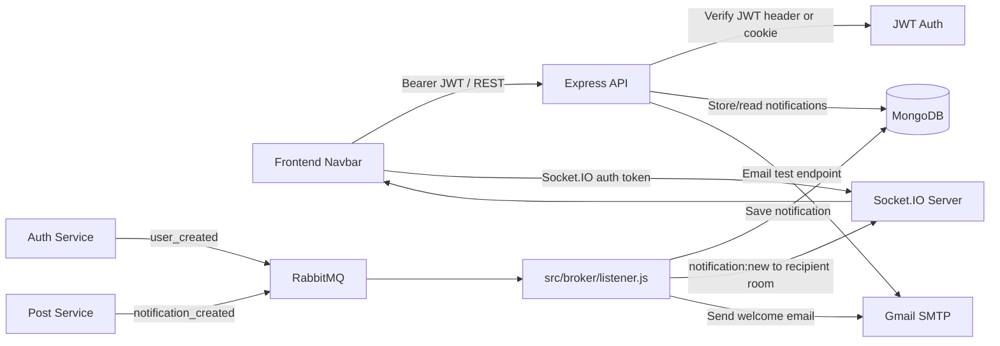

# Notification Service

This service handles email delivery, in-app notification storage, and real-time notification updates for VerbaScope.

## Overview

The notification service is an Express-based backend that connects to MongoDB, RabbitMQ, Socket.IO, and Gmail SMTP. It exposes authenticated notification endpoints for the frontend, consumes user and activity events from other services, stores in-app notifications, and sends account emails.

## Features

- Authenticated retrieval of notifications for the current user
- Marking all notifications or an individual notification as read
- Test email endpoint for SMTP validation
- RabbitMQ consumers for user-created email events and in-app notification events
- Socket.IO live updates routed to a room derived from the verified JWT user ID
- MongoDB persistence for notification history

## Architecture Diagram



For activity notifications, post-service publishes an event to RabbitMQ. The notification listener persists it, then emits `notification:new` to the recipient's authenticated Socket.IO room. The frontend also fetches recent notifications through the REST API to hydrate the dropdown after loading or reconnecting.

## Tech Stack

- Node.js + Express
- MongoDB + Mongoose
- Socket.IO for live updates
- RabbitMQ via amqplib
- Nodemailer for Gmail-based email delivery
- JWT authentication using an Authorization Bearer header (with a token-cookie fallback for HTTP endpoints)
- dotenv and CORS middleware

## Project Structure

- package.json - Service dependencies and `dev`, `start`, and placeholder `test` scripts
- server.js - Connects to MongoDB and RabbitMQ, configures the Socket.IO server and JWT handshake, starts queue consumers, and listens on the configured port
- src/app.js - Express logging, CORS, JSON/cookie parsing, JWT-protected notification API endpoints, and the unauthenticated test-email endpoint
- src/broker/rabbit.js - RabbitMQ connection, durable queue setup, reconnection attempts, and queue subscription helpers
- src/broker/listener.js - Consumers for `user_created` emails and `notification_created` persistence/live delivery
- src/config/config.js - Loads MongoDB, JWT, email, and RabbitMQ environment configuration
- src/email/email.js - Configures and verifies Gmail SMTP transport and sends plain-text/HTML email
- src/models/notification.model.js - Notification schema, allowed activity types, read state, and timestamps

## Environment Variables

Create a `.env` file in the service root with:

```env
MONGO_URI=your_mongodb_connection_string
JWT_SECRET=your_jwt_secret
RABBITMQ_URI=amqp://localhost
EMAIL_USER=your_gmail_address
EMAIL_PASS=your_gmail_app_password
CLIENT_URL=http://localhost:3002
PORT=3001
```

`JWT_SECRET` must match the secret used to sign auth-service tokens. `CLIENT_URL` is the frontend origin allowed by the Express and Socket.IO CORS configuration. `PORT` is optional and defaults to `3001`. `EMAIL_PASS` should be a Gmail app password when the account uses two-step verification.

## Installation

```bash
npm install
```

## Running the Service

Development mode:

```bash
npm run dev
```

Production mode:

```bash
npm start
```

The service listens on port 3001 by default.

## API Endpoints

### GET /api/notifications

Returns the 20 most recent notifications for the authenticated user and the unread count.

Accepts a valid JWT in the `Authorization: Bearer <token>` header, or falls back to the `token` cookie. Results are scoped to the authenticated user's ID.

### PATCH /api/notifications/read

Marks all unread notifications for the authenticated user as read.

Requires the same JWT authentication as the GET endpoint.

### PATCH /api/notifications/:id/read

Marks one notification as read, but only if it belongs to the authenticated user. Returns `404` if no matching notification exists.

Requires the same JWT authentication as the GET endpoint.

### POST /api/notification/test-email

Sends a test email. This endpoint does not require authentication. The `to` and `subject` fields are optional in the current implementation; omitted values use the code's built-in test recipient and subject.

Example body:

```json
{
  "to": "user@example.com",
  "subject": "Test notification"
}
```

## RabbitMQ Events

The service listens for these queues:

- user_created
  - Published by auth-service after local registration and Google OAuth callbacks
  - Sends a standard welcome email for local accounts or a Google data-sharing notice for Google accounts

- notification_created
  - Published by post-service for post activity such as likes, comments, and shares
  - Includes `recipientId`, `actorId`, `actorName`, `type`, and `postId`; shares may also include `reason`
  - Ignores events where the actor and recipient are the same user
  - Saves a notification in MongoDB and emits `notification:new` to the recipient's Socket.IO room

Expected payload for notification_created:

```json
{
  "recipientId": "user-id",
  "actorId": "actor-id",
  "actorName": "Alice",
  "type": "like",
  "postId": "post-id",
  "reason": null
}
```

## Socket.IO

The Socket.IO server shares the HTTP server with Express. Clients authenticate the handshake with `auth: { token }`; the server verifies the JWT and automatically joins the room named by the verified token's `id`. The client does not choose a room or send a separate join event. When the RabbitMQ listener persists a notification, it emits `notification:new` to that recipient room.

In the frontend, `Navbar.tsx` opens the socket using the stored token, prepends incoming notifications to the dropdown, and increments the unread badge. It also loads notification history through the REST endpoint. The database uses `isRead`; the frontend normalizes it to its `read` property.

## Notes

- Protected HTTP endpoints accept a valid Bearer token and fall back to the `token` cookie. Socket.IO requires a token in the handshake authentication data.
- RabbitMQ connection logic schedules a retry after an initial connection failure or a dropped connection.
- Email delivery depends on Gmail SMTP credentials being configured correctly.
- The `notification_created` consumer skips self-notifications. Notifications are stored with `isRead: false` by default and have Mongoose timestamps.
- Current integration caveat: post-service sends reply activity as `type: "reply"`, but the notification model only permits `like`, `comment`, and `share`. Reply events therefore fail schema validation and are not persisted by this consumer. Also, the listener's message builder formats `pass_forward`, while share events currently arrive as `type: "share"`; the persisted message for those events uses the generic fallback text.
- The RabbitMQ listener catches errors while handling user/notification events. Since the queue helper acknowledges messages once the callback completes, a caught processing failure does not automatically requeue that message.

## Interview Questions

### 📩 1. Notification Service: "How do notifications work? (File-to-Functionality Flow)"

**Answer:**

1. **Activity trigger:** A post-service controller handles a like, comment, or share. It resolves the actor's name (using the local user data and, for likes/comments, the shared user-resolution helper) and identifies the post owner as the recipient.
2. **Event publishing:** The controller calls `publish('notification_created', payload)` from `post-service/src/broker/rabbit.js`. The payload contains `recipientId`, `actorId`, `actorName`, `type`, and `postId`; a share can also include `reason`. The publisher sends the event to the durable `notification_created` queue.
3. **Queue consumption:** `notification-service/src/broker/listener.js` subscribes to `notification_created` through `src/broker/rabbit.js`.
4. **Persistence:** The listener ignores self-notifications, creates a `Notification` document using `src/models/notification.model.js`, and stores its generated message and read state in MongoDB.
5. **Real-time delivery:** After persistence, the listener emits `notification:new` using Socket.IO to the room identified by `recipientId`.
6. **Client authentication and display:** `server.js` verifies the Socket.IO handshake token and joins the socket to a room based on the verified JWT user ID. `frontend/components/Navbar.tsx` connects with its stored token, receives the event, prepends it to the dropdown, and increments the unread count. It fetches saved history over the REST API when the authenticated user loads.

**Important distinction:** Notification-service's HTTP middleware accepts a Bearer header first and a token cookie as fallback. Socket.IO does not use the cookie fallback; it requires `handshake.auth.token`. This prevents a client from choosing another user's notification room.

### 2. "How does the frontend keep the notification badge and history in sync?"

**Answer:** On the authenticated user's load, `Navbar.tsx` calls `GET /api/notifications`, which returns the 20 newest records plus a separately calculated unread count. Live `notification:new` events are prepended and increment the count. The user can mark all items read with `PATCH /api/notifications/read` or a single item with `PATCH /api/notifications/:id/read`; the API scopes both updates to the authenticated user. The frontend maps the database's `isRead` field to its `read` property.

### 3. "How are emails different for password and Google registration?"

**Answer:** Auth-service publishes `user_created` messages with an `authProvider`. The notification listener uses `authProvider: "google"` to send a Google account-data notice; other values use the standard welcome email. Both messages are sent through the Nodemailer Gmail transport configured in `src/email/email.js`. In the current integration, auth-service publishes this event on each successful Google OAuth callback, so that callback can trigger the Google notice again.

### 4. "How does the service route live events to the right user?"

**Answer:** The client sends its JWT in Socket.IO handshake auth. `server.js` verifies it and stores the decoded payload on the socket, then joins the socket to a room named after the verified `id`. The RabbitMQ listener emits to the room named by the event's `recipientId`. Because the room membership comes from a verified token rather than a client-provided user ID, a client cannot subscribe to another user's room by changing a join message.

### 5. "What happens if a RabbitMQ event cannot be processed?"

**Answer:** The RabbitMQ connection schedules reconnect attempts after connection failures or dropped connections. The listener logs event-processing errors, but its handlers catch those failures and return; the queue helper then acknowledges the message. Therefore, a handled persistence/email error is not automatically retried or requeued by the current implementation. This should be improved if guaranteed retry or dead-letter handling is required.