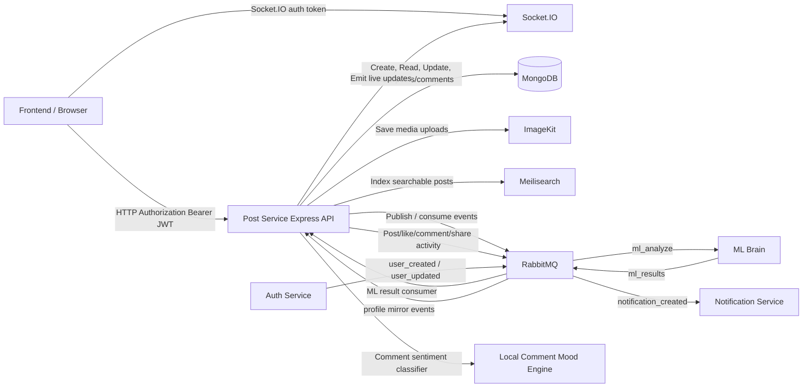

# VerbaScope Post Service

The Post Service is the Express and Socket.IO backend for VerbaScope posts and their social interactions. It stores posts and comments in MongoDB, uploads media to ImageKit, indexes posts in Meilisearch, tracks user pulse and interests, and exchanges asynchronous events with the auth, notification, and ML services through RabbitMQ.

## What this service does

It provides authenticated post, feed, comment, and social-interaction APIs; accepts image uploads; performs search and recommendation work; and coordinates live updates and asynchronous analysis with the rest of the platform.

## Responsibilities

- Create, read, and delete posts and comments.
- Support likes, shares, saves, replies, and dwell tracking.
- Build authenticated feeds, user-specific post lists, and recommendation data.
- Analyze post text asynchronously through the ML Brain and map model output into app-friendly signal states.
- Classify comment mood locally with a lightweight keyword-based classifier.
- Expose post and tag search through Meilisearch.
- Broadcast pulse, post, ML, and comment updates through Socket.IO.

## Architecture Diagram



## Directory And File Guide

```text
post-service/
├── server.js
├── package.json
├── package-lock.json
├── backfillSentiment.js
├── fix.mjs
├── .env                    # Local secrets/configuration
├── node_modules/           # Generated npm dependencies
├── src/
│   ├── app.js
│   ├── broker/
│   │   └── rabbit.js
│   ├── config/
│   │   └── config.js
│   ├── controllers/
│   │   ├── comment.controller.js
│   │   ├── dwell.controller.js
│   │   ├── like.controller.js
│   │   ├── post.controller.js
│   │   ├── recommendations.controller.js
│   │   ├── savedPost.controller.js
│   │   ├── search.controller.js
│   │   └── share.controller.js
│   ├── db/
│   │   └── db.js
│   ├── middlewares/
│   │   ├── auth.middleware.js
│   │   ├── upload.middleware.js
│   │   └── validation.middleware.js
│   ├── ml/
│   │   └── signalMapper.js
│   ├── models/
│   │   ├── comment.model.js
│   │   ├── like.model.js
│   │   ├── post.model.js
│   │   ├── savedPost.model.js
│   │   ├── user.model.js
│   │   └── userPulse.model.js
│   ├── pulse/
│   │   ├── pulse.js
│   │   └── updateUserPulse.js
│   ├── routes/
│   │   └── posts.routes.js
│   ├── scripts/
│   │   └── reindexPosts.js
│   ├── constants/
│   │   └── shareReasons.js
│   ├── search/
│   │   ├── meiliClient.js
│   │   ├── postIndex.js
│   │   └── searchHealth.js
│   ├── services/
│   │   └── commentSentiment.js
│   └── utils/
│       ├── authClient.js
│       ├── detectLanguage.js
│       ├── getVisibleAuthors.js
│       ├── imagekit.js
│       ├── normalizeText.js
│       └── resolveUser.js
└── README.md
```

### Root files and folders

| Path | Purpose |
| --- | --- |
| `server.js` | Application entrypoint. Connects MongoDB, seeds pulse state, initializes Meilisearch, starts RabbitMQ consumers, and creates the HTTP and Socket.IO server on port `3003` by default. |
| `package.json` | Defines the service metadata, npm scripts, and runtime dependencies. |
| `package-lock.json` | npm lockfile that records the resolved dependency tree for the service. |
| `backfillSentiment.js` | One-off migration script that recalculates sentiment for existing comments. |
| `fix.mjs` | Placeholder module; it is currently unused. |
| `.env` | Local runtime configuration and secrets. Do not commit or copy its values into documentation. |
| `node_modules/` | Generated npm dependency directory; it is not application source. |
| `README.md` | This documentation. |

### `src/`

| Path | Purpose |
| --- | --- |
| `src/app.js` | Configures Express with Morgan logging, CORS, JSON parsing, cookie parsing, and mounts the post routes at `/api/posts`. |
| `src/broker/rabbit.js` | Owns the RabbitMQ connection, queue declarations, event publishing, ML-result consumption, and reconnect behavior. |
| `src/config/config.js` | Reads MongoDB, broker, JWT, HTTP, client, and ImageKit configuration from environment variables and defaults. |
| `src/db/db.js` | Opens the MongoDB connection used by the service. |
| `src/routes/posts.routes.js` | Registers all post, feed, interaction, search, dwell, recommendation, and pulse routes. |
| `src/controllers/post.controller.js` | Creates, reads, feeds, deletes, and updates persisted ML analysis on posts. |
| `src/controllers/comment.controller.js` | Creates and deletes comments and replies, and exposes comment mood data. |
| `src/controllers/like.controller.js` | Adds and removes post likes, updates counters, publishes notifications/events, and updates user pulse. |
| `src/controllers/share.controller.js` | Adds and removes shares, validates share reasons, updates counters, and updates user pulse. |
| `src/controllers/savedPost.controller.js` | Saves, unsaves, and paginates the current user's saved posts. |
| `src/controllers/dwell.controller.js` | Records qualifying post dwell activity; visits under three seconds are ignored. |
| `src/controllers/recommendations.controller.js` | Generates user recommendations from persisted interest data and user relationships. |
| `src/controllers/search.controller.js` | Handles post search, tag facet search, and exact tag-filtered search. |
| `src/constants/shareReasons.js` | Defines the valid community-share reasons used by validation and the post schema. |

### `src/middlewares/`

| Path | Purpose |
| --- | --- |
| `auth.middleware.js` | Verifies a JWT from the `Authorization: Bearer <token>` header, falling back to the `token` cookie, and attaches the authenticated user context. |
| `upload.middleware.js` | Configures memory uploads, accepts JPEG/PNG/WEBP/GIF images only, limits each file to 5 MB, and allows at most four files. |
| `validation.middleware.js` | Validates post and comment request data before controller execution. |

### `src/ml/`

| Path | Purpose |
| --- | --- |
| `signalMapper.js` | Maps ML Brain risk outputs such as `green`, `yellow`, and `red` into the app's human-readable signal states used in post analysis and UI display. |

### `src/models/`

| Path | Purpose |
| --- | --- |
| `post.model.js` | Mongoose schema for post text, tags, media, author data, counters, sentiment/ML fields, share-reason counts, and indexes. |
| `comment.model.js` | Mongoose schema for comments and replies, including sentiment fields and indexes. |
| `like.model.js` | Standalone unique user/post like relation model. The current controller path still uses direct post updates rather than this model for core like behavior. |
| `savedPost.model.js` | Stores the user-to-post save relation and prevents duplicate saves for a user/post pair. |
| `user.model.js` | User reference model used in post author and relationship lookups. |
| `userPulse.model.js` | Stores normalized interest data used for recommendations and pulse-based ranking. |

### `src/pulse/`

| Path | Purpose |
| --- | --- |
| `pulse.js` | Maintains the in-memory trending and signal state used by the pulse widget and real-time UI updates. |
| `updateUserPulse.js` | Increments user pulse when a user likes, comments, shares, or dwells on a post. |

### `src/search/` and `src/scripts/`

| Path | Purpose |
| --- | --- |
| `meiliClient.js` | Builds and initializes the Meilisearch client and index bootstrap logic. |
| `postIndex.js` | Converts post documents into searchable payloads for the Meilisearch `posts` index. |
| `searchHealth.js` | Simple health-check helper for the Meilisearch integration. |
| `reindexPosts.js` | One-off backfill script to rebuild the Meilisearch index from MongoDB. |

### `src/services/` and `src/utils/`

| Path | Purpose |
| --- | --- |
| `commentSentiment.js` | Lightweight keyword/emoji sentiment scorer that returns positive, negative, or neutral labels. |
| `authClient.js` | Small helper for auth-service interaction and user resolution during post operations. |
| `detectLanguage.js` | Synchronous script-based heuristic that labels content as English, Bangla, or mixed. |
| `imagekit.js` | Uploads post media to ImageKit and returns the resulting CDN URL. |
| `normalizeText.js` | Normalizes user content before indexing, mood scoring, or ML analysis. |
| `getVisibleAuthors.js` | Resolves the current user plus followed users for personalized community-signal filtering. |
| `resolveUser.js` | Reads the local user mirror and falls back to auth-service, then upserts the fetched profile locally to heal missing mirror entries. |

## Requirements And Setup

- Node.js 18+ recommended.
- MongoDB instance reachable through `MONGO_URI`.
- RabbitMQ broker reachable through `RABBITMQ_URI`.
- Meilisearch instance reachable through the default local client configuration or environment override.
- Auth-service reachable through `AUTH_SERVICE_URL` for author/profile lookups.
- ImageKit credentials for image uploads.
- JWT secret shared with auth-service so Bearer tokens and the `token` cookie can be verified consistently.

Install dependencies:

```bash
npm install
```

## Environment Variables

The service reads configuration from `.env` and a few values have safe defaults in `src/config/config.js`.

| Variable | Required | Description |
| --- | --- | --- |
| `MONGO_URI` | Yes | MongoDB connection string for the post database. |
| `RABBITMQ_URI` | No | RabbitMQ connection string; defaults to `amqp://localhost:5672`. |
| `JWT_SECRET` | Yes | Shared secret used to validate JWTs from the Authorization header or cookie. |
| `PORT` | No | HTTP port for the service; defaults to `3003`. |
| `CLIENT_URL` | No | Client origin used for local CORS configuration; defaults to `http://localhost:3002`. |
| `AUTH_SERVICE_URL` | Yes for profile lookups | Base URL of auth-service; used for user bulk lookups and profile fallback. |
| `MEILI_HOST` | No | Meilisearch URL; defaults to `http://localhost:7700`. |
| `MEILI_MASTER_KEY` | No | Meilisearch API key; defaults to a development placeholder and should be overridden outside local development. |
| `IMAGEKIT_PUBLIC_KEY` | Yes for uploads | Public key for image upload / URL generation. |
| `IMAGEKIT_PRIVATE_KEY` | Yes for uploads | Private key used by the ImageKit SDK. |
| `IMAGEKIT_URL_ENDPOINT` | Yes for uploads | ImageKit URL endpoint used when building final image links. |

Keep all credentials in `.env` or the deployment secret manager.

## Running

Start the service in production-like mode:

```bash
npm start
```

Start it in development with automatic reload:

```bash
npm run dev
```

The server exposes the HTTP API on the configured port and also starts a Socket.IO server for live post and pulse updates.

## HTTP API

All routes below are mounted under `/api/posts`. Protected routes accept a valid `Authorization: Bearer <token>` JWT and fall back to the `token` cookie. Socket.IO authentication uses the token in the handshake auth payload.

| Method | Route | Auth | Description |
| --- | --- | --- | --- |
| `GET` | `/api/posts/pulse/trending` | Yes | Gets the current week's trending topic and activity summary. |
| `GET` | `/api/posts/pulse/signal` | No | Gets the live pulse signal object. |
| `GET` | `/api/posts/community-signals/summary` | Yes | Summarizes recent share reasons from the current user and followed users. |
| `GET` | `/api/posts/:id/community-endorsements` | Yes | Lists people who shared/marked a post and their reason/time. |
| `GET` | `/api/posts/search/health` | No | Verifies Meilisearch health and returns status information. |
| `GET` | `/api/posts/search` | Yes | Full-text searches indexed post content using a query and pagination. |
| `GET` | `/api/posts/search/tags` | Yes | Performs a tag/facet search for matching post tags. |
| `GET` | `/api/posts/tag/:tagName` | Yes | Returns posts filtered to the specified tag. |
| `POST` | `/api/posts/admin/reindex-search` | Yes | Rebuilds the Meilisearch index from MongoDB; the route currently checks for a valid JWT but does not enforce a role. |
| `POST` | `/api/posts/admin/reanalyze` | Yes | Queues text posts without a risk result for ML analysis; the route currently checks for a valid JWT but does not enforce a role. |
| `POST` | `/api/posts/` | Yes | Creates a text and/or image post; publishes text for asynchronous ML analysis. |
| `GET` | `/api/posts/feed` | Yes | Returns the current user’s feed with state flags for likes/saves. |
| `GET` | `/api/posts/user/:userId` | Yes | Returns posts created by a specific user. |
| `GET` | `/api/posts/saved` | Yes | Returns the current user’s saved posts. |
| `GET` | `/api/posts/:id` | Yes | Returns a single post with viewer-specific flags. |
| `DELETE` | `/api/posts/:id` | Yes | Deletes the current user’s post. |
| `POST` | `/api/posts/:id/like` | Yes | Adds a like and emits socket/post update events. |
| `DELETE` | `/api/posts/:id/unlike` | Yes | Removes a like. |
| `POST` | `/api/posts/:id/share` | Yes | Records a share and optionally stores a reason. |
| `DELETE` | `/api/posts/:id/unshare` | Yes | Removes a share. |
| `POST` | `/api/posts/:id/save` | Yes | Saves a post to the current user’s bookmarks. |
| `DELETE` | `/api/posts/:id/unsave` | Yes | Removes a saved post bookmark. |
| `POST` | `/api/posts/dwell` | Yes | Records dwell time for a post when the user spends enough time viewing it. |
| `GET` | `/api/posts/recommendations/users` | Yes | Returns recommended users based on pulse and relationship signals. |
| `GET` | `/api/posts/:id/pulse/mood` | Yes | Returns the current comment mood distribution for a post. |
| `GET` | `/api/posts/:id/comments` | Yes | Returns top-level comments, newest first. |
| `GET` | `/api/posts/comments/:commentId/replies` | Yes | Returns replies to a comment, oldest first. |
| `POST` | `/api/posts/:id/comment` | Yes | Creates a comment or reply, classifies its sentiment, and updates counts/mood. |
| `DELETE` | `/api/posts/:postId/comments/:commentId` | Yes | Deletes a comment authored by the current user. |

### Request details

- `POST /api/posts` accepts multipart form data in the `images` field plus optional `content`. Hashtags are extracted from content; `tags` are not accepted as a separate post field. Content is limited to 3,000 characters; a post must contain non-empty text or at least one image.
- `POST /api/posts/:id/share` stores a reason only when it matches one of `agree`, `funny`, `needs_attention`, `insightful`, `concerning`, or `educational`; an invalid or missing reason is stored as `null`.
- `POST /api/posts/dwell` records dwell activity only when the session meets the service’s minimum dwell threshold.
- Most response payloads include state flags such as `likedByMe`, `bookmarkedByMe`, and `isOwner` when the viewer is known.
- Search pagination clamps limits to 1–50 and offsets to zero or greater. Feed pagination defaults to 10 posts and caps the limit at 50.

## RabbitMQ Integration

RabbitMQ is used for asynchronous communication between the post service and the rest of the platform.

- The application sends messages to named queues through RabbitMQ's default exchange; it does not configure a custom exchange or routing topology.
- `ml_analyze` carries `{ postId, text }` jobs to ML Brain. The queue is durable and post-service sends persistent messages.
- `ml_results` carries completed analyses from ML Brain back to post-service. The queue is durable; after the result is saved to MongoDB it is broadcast to connected clients.
- `notification_created` carries likes, comments, and shares to notification-service. It is a durable queue and post-service publishes persistent messages.
- `pulse_events` carries `post.created`, `post.liked`, `comment.added`, and `post.shared` events for the in-memory pulse engine; this queue is declared non-durable.
- `user_created` and `user_updated` carry auth-service profile mirror updates. Post-service consumes both; notification-service also consumes `user_created` for welcome emails.
- The Node.js RabbitMQ clients retry failed initial connections and schedule a reconnect after a connection closes. This is not full consumer recovery: queue consumers are registered by server startup, and the post-service reconnect path does not re-register its pulse and ML-result consumers. The Python ML Brain consumer has no automatic reconnect loop.
- `ml_results` processing failures are negatively acknowledged without requeue. Post-service's `notification_created` and profile queue consumers also nack failures without requeue; the ML Brain nacks failed analysis jobs without requeue. Pulse messages are acknowledged after their event handler runs.

## Search And Pulse Behavior

- A Meilisearch index is initialized at startup and is treated as non-critical; the app continues if search is temporarily unavailable.
- MongoDB is the source of truth; Meilisearch's `posts` index is derived search data. `initMeilisearch()` ensures that the index exists with `_id` as its primary key and applies `tags` as a filterable attribute on every initialization.
- After index initialization, `server.js` checks `postsIndex().getStats()`. If `numberOfDocuments === 0`, it calls `rebuildSearchIndex()` to reconstruct documents from MongoDB. This recovers an empty index after an ephemeral-disk wipe, but it does not reconcile a non-empty index with every MongoDB change. Meilisearch failures during startup are logged and do not prevent the HTTP server from starting.
- The startup rebuild reads the MongoDB posts with `Post.find().lean()` and looks up author data through auth-service as it indexes. The manual `node src/scripts/reindexPosts.js` script is separate and processes posts in batches of 100. Neither strategy should be described as a streamed MongoDB cursor.
- Post indexing is started asynchronously after post creation. Search documents include post content, normalized content, tags, author name/avatar, language, word count, image count, and creation time; they do not currently include post counters or ML-analysis fields.
- Search supports full-text queries, tag facet suggestions, and exact tag filtering. Search/tag-facet errors currently return an empty successful result; tag-detail errors return HTTP 500.
- Pulse data is seeded from the database on startup and then updated in real time from likes, comments, shares, and ML-driven events.
- The Community Consensus filter uses share reasons from the previous seven days by the current user and users they follow, regardless of who authored the post. The AI risk filter is platform-wide and independent of Community Consensus.

### 🔍 Full-Text Search System (Meilisearch Integration)

VerbaScope uses **Meilisearch** as a derived full-text search index alongside MongoDB. Meilisearch provides typo tolerance and prefix matching, with typical query execution designed to complete in under 50 ms depending on deployment and index size. Searchable post documents include post text, hashtags, author names, and author avatar URLs; the avatar is also included as display metadata in search results.

#### Architecture And Design Principles

- **Source of truth:** MongoDB remains the primary database. Meilisearch is a disposable derived index that can be wiped and rebuilt from MongoDB.
- **Non-blocking indexing:** Post creation and deletion update MongoDB first, then start Meilisearch indexing or deletion asynchronously so search work does not delay the HTTP response. Indexing failures are logged.
- **Self-healing after ephemeral-disk resets:** On platforms with ephemeral filesystems, a restart can remove Meilisearch's local `data.ms` index. During startup, `server.js` checks `postsIndex().getStats()` and calls `rebuildSearchIndex()` when the index contains zero documents.

#### Core Search Modules

| File | Responsibility |
| --- | --- |
| `src/search/meiliClient.js` | Initializes the Meilisearch SDK client, ensures the `posts` index exists with `_id` as its primary key, and applies `tags` as a filterable attribute. |
| `src/search/postIndex.js` | Formats indexed post documents and exports `indexPost()`, `updateIndexedPost()`, `deleteIndexedPost()`, `searchPosts()`, tag-search helpers, and `rebuildSearchIndex()`. |
| `src/search/searchHealth.js` | Checks Meilisearch connection status and returns health information. |
| `src/scripts/reindexPosts.js` | Standalone CLI script to backfill or re-index MongoDB posts into Meilisearch. Run with `node src/scripts/reindexPosts.js` from the post-service directory. |

#### Search API Endpoints

| Method | Endpoint | Auth | Description |
| --- | --- | --- | --- |
| `GET` | `/api/posts/search/health` | Public | Returns Meilisearch health, for example `{ "status": "ok", "meilisearch": "available" }`. |
| `GET` | `/api/posts/search?q=<term>&limit=<n>&offset=<n>` | Required | Searches indexed posts; pagination defaults to 20 results and clamps the limit to 1–50. |
| `GET` | `/api/posts/search/tags?q=<term>&limit=<n>` | Required | Returns matching tag suggestions ordered by usage; the limit defaults to 8. |
| `GET` | `/api/posts/tag/:tagName?limit=<n>&offset=<n>` | Required | Returns posts with an exact matching tag, with paginated results. |
| `POST` | `/api/posts/admin/reindex-search` | Required | Rebuilds the search index from MongoDB. |

## Socket.IO Events

The service emits real-time events for the frontend, including:

- `pulse:trending` when trending signal information changes.
- `pulse:update` for general pulse updates.
- `pulse:mood` when comment mood distribution is recalculated.
- `post:update` when like, comment, or share counters change.
- `post:deleted` when a post is removed.
- `post:ml-analysis` when an asynchronous ML result is stored.
- `comment:reply` when a reply is added.
- `community-insights:update` when a share reason is added or removed.

The server also logs socket connect and disconnect events for diagnostics.

## Maintenance Scripts

| Script | Purpose |
| --- | --- |
| `backfillSentiment.js` | Re-runs comment sentiment analysis for existing comments that were created before the local classifier was standardized. |
| `src/scripts/reindexPosts.js` | Manually rebuilds the Meilisearch post index from MongoDB in batches of 100; run with `node src/scripts/reindexPosts.js`. |

## Npm Scripts And Testing

```json
{
  "scripts": {
    "test": "echo \"Error: no test specified\" && exit 1",
    "start": "node server.js",
    "dev": "npx nodemon server.js"
  }
}
```

There is currently no automated test suite in this folder. Validate changes with the service integrations, maintenance scripts, and API workflows relevant to the change.

## Operational Notes

- The service uses `express.json()` and cookie parsing, and it applies explicit local CORS allow-listing for the frontend origins.
- HTTP protected routes prioritize the Bearer header and use a cookie only as fallback. The Socket.IO server requires a JWT in `handshake.auth.token`; it rejects unauthenticated or invalid handshakes.
- The app treats Meilisearch and RabbitMQ as resilient dependencies: failed startup does not stop the HTTP server from serving requests.
- Uploads are restricted to image files and capped at 5 MB per file, with a maximum of four files per request.
- Routing carefully handles `/saved` before the generic `/:id` route to avoid incorrect route resolution.
- Local state and counters are updated in MongoDB plus the in-memory pulse engine to keep the UI responsive.
- `updateUserPulse.js` updates hashtag interest weights by +2 for a like, +3 for a comment, +4 for a share, and +1 for qualifying dwell; dwell under 3,000 ms is ignored.
- Likes are stored on post documents using `likedBy` and `likesCount`; the standalone `Like` model is not used by the current like controller. Saved posts use a separate relation with a unique `(user, post)` index and upsert-based save operation.
- The local comment classifier returns positive, negative, or neutral sentiment and a score based on keyword, emoji, negation, and selected masked-profanity matches. It is not a sarcasm/toxicity model; comment mood is derived from stored comment sentiment counts.
- Integration caveats: comment replies are published to notification-service as `type: "reply"`, but that service's current notification schema does not allow `reply`; share notifications use `type: "share"` while notification-service's message builder formats `pass_forward`, causing the generic fallback message for shares.

## Project Status

The Post Service is active and is the primary backend for social posting, interaction tracking, search, and recommendation behavior in VerbaScope. It is designed to operate with MongoDB, RabbitMQ, Meilisearch, ImageKit, and the shared auth system while remaining tolerant of non-critical service failures during startup.

## Interview Questions

### 📝 1. Post Creation & Media Uploads: "How does post creation with images work under the hood?"

**Answer:**

1. **Route and validation:** The client sends `POST /api/posts` with `multipart/form-data`. `src/routes/posts.routes.js` applies JWT authentication, then `src/middlewares/upload.middleware.js` parses the `images` field into memory. It accepts up to four JPEG, PNG, WEBP, or GIF files, each up to 5 MB. `src/middlewares/validation.middleware.js` checks that optional content is a string no longer than 3,000 characters.
2. **Image storage:** `src/controllers/post.controller.js` rejects requests with neither non-blank content nor images. It uploads the image buffers concurrently using `src/utils/imagekit.js`, which stores them in ImageKit's `/posts` folder and returns CDN URLs.
3. **Post document:** The controller extracts hashtags from the content, detects a quick language (`en`, `bn`, or `mixed`), normalizes selected Bangla transliterations, counts words, and sets the pulse topic to the first hashtag or `general`. It then creates a MongoDB `Post` with the text and image URLs.
4. **Asynchronous work:** It publishes `post.created` for pulse tracking and publishes `{ postId, text }` to `ml_analyze` only when text is present. It fetches the author's profile from auth-service for the response and starts Meilisearch indexing without awaiting index completion.
5. **Response:** It returns HTTP `201` with the created post and author data. The endpoint is not guaranteed to complete in a fixed time such as 0.1 seconds: image uploads and the author lookup are awaited before the response.

Hashtags are extracted from the post text; the controller does not accept a separate `tags` field. Image-only posts are supported and are not queued for text analysis.

### 🔄 2. Social Interactions: "How do likes, shares, saves, and dwell tracking work?"

**Answer:**

- **Likes:** `POST /api/posts/:id/like` checks the post and existing `likedBy` entries, adds the user ID and increments `likesCount`, updates the in-memory pulse and the user's hashtag interest score (+2), emits `post:update`, and asynchronously publishes a `notification_created` event for the post author. Unlike removes the user from `likedBy` and updates the live counter.
- **Shares:** `POST /api/posts/:id/share` records the user, optional reason, and timestamp in `sharedBy`; it updates `sharesCount` and the matching reason counter. Reasons are `agree`, `funny`, `needs_attention`, `insightful`, `concerning`, and `educational`; invalid values become `null`. Sharing adds +4 to the user's hashtag interest scores and can publish a notification. `unshare` removes the mark and decrements its reason counter.
- **Saves/bookmarks:** `savedPost.controller.js` stores a separate user/post relation. A unique compound index on `(user, post)` prevents duplicate records; save uses an upsert so repeated clicks remain idempotent.
- **Dwell:** The authenticated client posts `{ postId, duration }` to `/api/posts/dwell`. Durations below 3,000 ms are ignored; qualifying reads add +1 to the user's hashtag interest scores.

`src/pulse/updateUserPulse.js` applies the interest weights to hashtags extracted from the post content. Comments add +3.

### 🔍 3. Search System & Self-Healing Index: "How does post-service integrate with Meilisearch?"

**Answer:**

1. **Source of truth:** MongoDB is authoritative for post data. Meilisearch is a derived index for typo-tolerant search across indexed post text and tags, plus author name/avatar fields stored in each search document. The service doesn't write posts to Meilisearch as its primary persistence layer.
2. **Startup and ephemeral storage recovery:** `server.js` initializes Meilisearch, ensures the `posts` index exists with `_id` as primary key, and reapplies the `tags` filterable-attribute setting. It then checks index statistics. If `numberOfDocuments === 0`, the startup self-healing path calls `rebuildSearchIndex()` to repopulate from MongoDB. This is specifically an empty-index recovery path, not a full reconciliation of stale documents. Meilisearch is non-critical; startup continues if it is unavailable.
3. **Backfill implementations:** Startup's `rebuildSearchIndex()` loads posts with `Post.find().lean()` and indexes them while resolving author profiles. For a manual rebuild, `src/scripts/reindexPosts.js` processes MongoDB results in batches of 100. There are no separate Phase 0–Phase 5 Markdown guides in this service folder; this README documents the current implementation.
4. **Live indexing and queries:** Post creation starts `indexPost()` asynchronously after the author lookup. Search documents include content, normalized content, tags, author name/avatar, language, word count, image count, and creation time. Search clamps page parameters; tag suggestions use facets and tag pages use an exact tag filter. Counters and ML-analysis fields are not currently indexed.

The empty-index check is why a wiped Meilisearch disk can recover without manual intervention after a successful startup and MongoDB/auth-service lookups. It does not make Meilisearch durable storage or guarantee that every indexing failure is repaired automatically.

### 📬 8. RabbitMQ Queues And Delivery: "What messages flow through RabbitMQ, and how reliable is processing?"

**Answer:**

The code uses named queues via `sendToQueue()` (RabbitMQ's default exchange), not a custom exchange. The main cross-service flows are:

- `ml_analyze`: post-service publishes `{ postId, text }` for text posts; ML Brain consumes it.
- `ml_results`: ML Brain publishes `ml.analysis.completed`; post-service consumes the result, updates the MongoDB post, and acknowledges it after successful handling.
- `notification_created`: post-service publishes activity notification payloads; notification-service persists them and emits a socket notification.
- `pulse_events`: post-service sends post/like/comment/share events for pulse updates. This queue is non-durable.
- `user_created` and `user_updated`: auth-service profile events are consumed by post-service to maintain its user mirror; notification-service also consumes `user_created`.

The ML and notification queues are declared durable and their publishers mark relevant messages persistent. Consumer failures are generally nacked with `requeue=false`, so failed messages are not automatically retried. Both Node.js broker clients schedule connection retries, but reconnecting the socket does not automatically restore every previously registered consumer in the current implementation: post-service does not re-register its pulse/ML-result consumers, and notification-service's listener subscriptions are started separately at app startup. The Python ML Brain's `pika.BlockingConnection` consumer has no reconnect loop and its daemon thread exits if connection or consumption fails. Therefore it would be inaccurate to claim that all workers automatically recover and resume processing after network drops.

### 🖼️ 9. Media Upload And CDN: "Why use ImageKit instead of writing files to the service disk or managing S3 directly?"

**Answer:**

`src/routes/posts.routes.js` applies auth and then Multer's `memoryStorage()` upload middleware for the `images` field. `src/middlewares/upload.middleware.js` accepts JPEG, PNG, WebP, and GIF MIME types, enforces a maximum of 5 MB per file and up to four files, and rejects unsupported types. The uploaded buffers are passed to `src/utils/imagekit.js`, which uploads them to the ImageKit `/posts` folder and returns CDN URLs; the post document stores those URLs rather than local file paths or file bytes.

This keeps post-service from relying on instance-local disk for uploaded media, which is useful for stateless/ephemeral deployments, and delegates image delivery to ImageKit's CDN. The code demonstrates ImageKit integration, but it does not document a specific architectural decision against Amazon S3 or compare their costs/features; describe ImageKit as the chosen CDN/storage integration rather than claiming S3 was rejected for a particular reason.

### 💬 4. Comment Pipeline & Local Mood Classifier: "How do comments work, and why not run the heavy ML model for every comment?"

**Answer:** `POST /api/posts/:id/comment` validates comment text (required, at most 500 characters), checks the post and optional parent comment, and calls `src/services/commentSentiment.js`. This is a lightweight local word/emoji/negation classifier that saves a positive, negative, or neutral label and a score when the comment is created. It is not an ML Brain sarcasm or toxicity prediction. Comments store a `parentComment` reference and `repliesCount`; top-level comments and replies have separate read endpoints. After creation, the controller recalculates the post's mood distribution from the stored comment collection and emits `pulse:mood`, along with comment-count and reply events.

### 📡 5. Asynchronous ML Result Consumption: "How does post-service handle results coming back from ML Brain?"

**Answer:**

1. When a post with text is created, `post.controller.js` publishes `{ postId, text }` to the durable `ml_analyze` RabbitMQ queue.
2. ML Brain consumes the job and eventually publishes an analysis result to `ml_results`. At startup, `server.js` registers the consumer using `consumeMLResults()` in `src/broker/rabbit.js`.
3. `handleMLResult()` validates the `postId`, maps `risk_flag` through `src/ml/signalMapper.js`, and stores the language, sentiment, sarcasm, toxicity, confidence, risk, explanation, derived signal, and analysis timestamp in the post's `mlAnalysis`.
4. After saving, it emits `post:ml-analysis` with the post ID and analysis payload so connected frontend clients can refresh the AI signal without polling.

### 6. "How do user pulse and recommendations work?"

**Answer:** Likes, comments, shares, and qualifying dwell events increment hashtag interest weights in the `UserPulse` record (+2, +3, +4, and +1 respectively). The recommendations controller ranks interest tags, finds other users who authored posts matching those tags, excludes the current user and followed accounts, and returns up to five profiles. Recommendation profile data is fetched from auth-service when available, with the local user mirror as a fallback.

### 7. "How does post-service handle downstream services and missing user profiles?"

**Answer:** RabbitMQ consumers mirror `user_created` and `user_updated` profile events into the local `User` collection. When an interaction needs an actor profile, `resolveUser()` first checks that mirror and falls back to auth-service; if it finds the user remotely, it upserts the profile locally so a later lookup can use the repaired mirror. Activity notifications are published to the `notification_created` queue. One current cross-service mismatch is that reply notifications are published with `type: "reply"`, but notification-service currently permits only `like`, `comment`, and `share`, so its schema rejects reply notifications.
